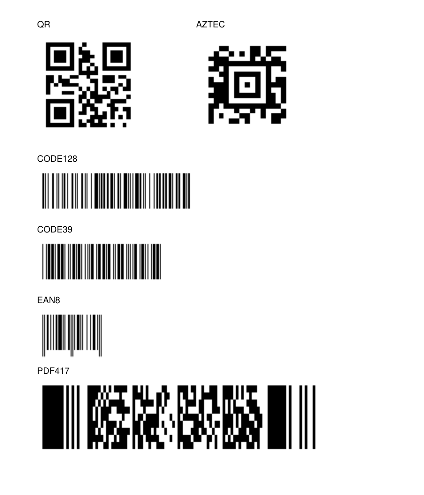

.. include:: ../../header.rst

==============================
12-Barcodes
==============================

Write several barcode types, including QR, with :meth:`Page.WriteBarcode`, then read them back with :meth:`Page.ReadBarcodes`.

GitHub: `12-Barcodes <https://github.com/ArtifexSoftware/MuPDF.NET.Examples/tree/main/MuPDF.NET/12-Barcodes>`_ in `MuPDF.NET.Examples <https://github.com/ArtifexSoftware/MuPDF.NET.Examples>`_.

The method creates a one-page PDF with QR, Aztec, Code 128, Code 39, EAN-8, and PDF417. Square 2D codes use ``forceFitToRect: true``. Linear codes use a short clip height (that value is the bar height in pixels). Each type is read back with a matching :ref:`BarcodeFormat <Barcode_BarcodeFormat>`. EAN-8 returns the payload plus check digit (``12345670``).

.. code-block:: cs

    /// 
Write several barcode types (including QR) to a PDF, then read them back

    static void WriteAndReadBarcode(string outputPath)
    {
        // Clip size is encoding pixels (1pt = 1px). 1D codes need a short height (bar height).
        // PDF417 is last: its placed image is taller than the clip.
        var samples = new (BarcodeFormat format, string text, Rect rect, bool fit)[]
        {
            (BarcodeFormat.QR, "https://mupdf.com", new Rect(40, 36, 160, 156), true),
            (BarcodeFormat.AZTEC, "MuPDF.NET", new Rect(220, 36, 340, 156), true),
            (BarcodeFormat.CODE128, "Hello World!", new Rect(40, 188, 340, 228), false),
            (BarcodeFormat.CODE39, "CODE39", new Rect(40, 268, 340, 308), false),
            (BarcodeFormat.EAN8, "1234567", new Rect(40, 348, 240, 388), false),
            (BarcodeFormat.PDF417, "Hello World!", new Rect(40, 428, 340, 436), false),
        };

        using (var doc = Document.Open())
        {
            using Page page = doc.NewPage(width: 480, height: 560);
            var writer = new TextWriter(page.Rect);
            var font = new Font(fontName: "helv");

            foreach (var (format, text, rect, fit) in samples)
            {
                writer.FillTextbox(
                    new Rect(rect.X0, rect.Y0 - 16, rect.X1 + 120, rect.Y0),
                    format.ToString(),
                    font,
                    fontSize: 10);
                page.WriteBarcode(
                    rect,
                    text,
                    format,
                    forceFitToRect: fit,
                    pureBarcode: true,
                    marginLeft: 8,
                    marginTop: 8,
                    marginRight: 8,
                    marginBottom: 8);
            }

            writer.WriteText(page);
            doc.Save(outputPath);
        }

        using (var doc = Document.Open(outputPath))
        using (Page page = doc[0])
        {
            Console.WriteLine($"barcodeCount={samples.Length}");
            foreach (var (format, _, _, _) in samples)
            {
                // Scan the page for this format so clip size vs placed image size cannot miss.
                var found = page.ReadBarcodes(barcodeFormat: format)
                    .FirstOrDefault(b => b.BarcodeFormat == format);
                Console.WriteLine($"{format}\t{found?.Text}");
            }
        }
    }

API: :meth:`Document.Open`, :meth:`Document.NewPage`, :meth:`Page.WriteBarcode`, :meth:`Page.ReadBarcodes`, :attr:`Barcode.BarcodeFormat`, :attr:`Barcode.Text`, :meth:`Document.Save`.

Result of ``page.ReadBarcodes``:

.. literalinclude:: barcodes.txt
   :language: text

Result of ``barcodes.pdf`` (page 1 rendered at 2×):

.. include:: ../../footer.rst
