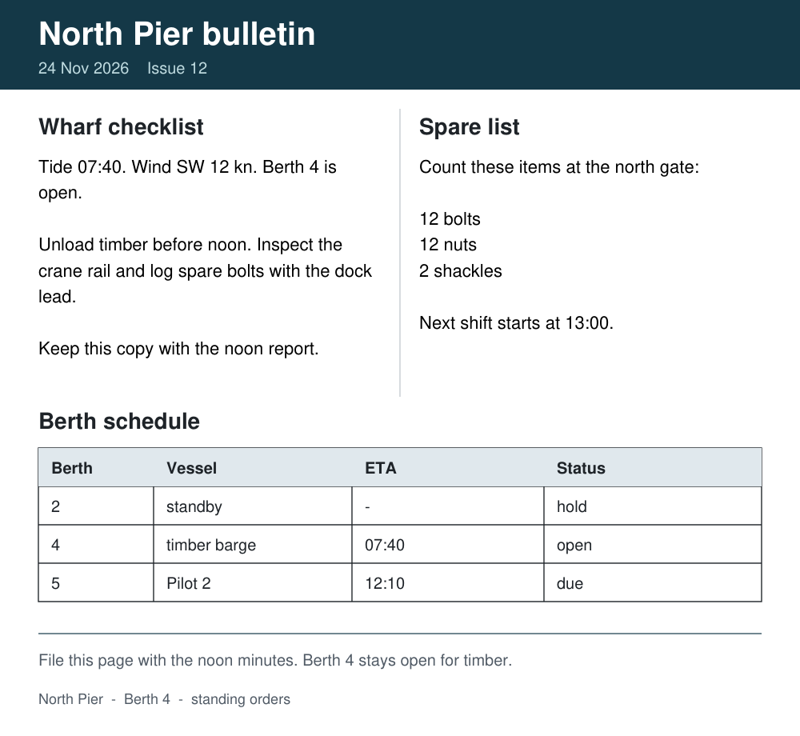

.. include:: ../../header.rst

==============================
35-ToChunks
==============================

Split a PDF into retrieval-ready chunks with ``Document.ToChunks``.

GitHub: `35-ToChunks <https://github.com/ArtifexSoftware/MuPDF.NET.Examples/tree/main/MuPDF.NET/35-ToChunks>`_ in `MuPDF.NET.Examples <https://github.com/ArtifexSoftware/MuPDF.NET.Examples>`_.

``bulletin.pdf`` is the same one-page North Pier bulletin as :doc:`32-ToMarkdown </examples/markdown/index>` (500×460). ``MuPDF4LLM.SetLayout(true)`` selects the layout path. ``Document.ToChunks`` returns a ``ChunkedDocument`` of ``Chunk`` items (``Id``, ``Text``, ``Metadata.TokenCount``, page range). Default ``maxTokens`` is 400 and ``minTokens`` is 120; headings still split because ``respectSectionStarts`` is ``true``. ``useOcr`` is ``false`` because this PDF is already text. Without a layout worker, the method prints ``LAYOUT_UNAVAILABLE`` and skips chunking. The listing is UTF-8 without a BOM.

To **convert the same PDF to Markdown** with layout off, see :doc:`32-ToMarkdown </examples/markdown/index>`. For **layout JSON**, see :doc:`33-ToJsonLayout </examples/json/index>`. For **layout plain text**, see :doc:`34-ToText </examples/totext/index>`. For **OCR on a scan**, see :doc:`36-Ocr </examples/ocr/index>`. For **one LlamaIndex document per page**, see :doc:`38-LlamaMarkdownReader </examples/llamareader/index>`. To **embed chunks and Ask / Search**, see :doc:`41-LoadAi </examples/loadai/index>`.

.. code-block:: cs

    /// 
Split a PDF into retrieval-ready chunks (requires the optional layout worker)

    static void ToChunks(string inputPath, string outputPath)
    {
        // Remember prior layout flag so we restore it for other examples in the same process.
        bool prior = MuPDF4LLM.LayoutEnabled;
        try
        {
            // ToChunks requires UseLayout=true and a registered layout worker.
            if (!MuPDF4LLM.LayoutAvailable)
            {
                Console.WriteLine("LAYOUT_UNAVAILABLE");
                return;
            }

            MuPDF4LLM.SetLayout(true);

            using var doc = Document.Open(inputPath);
            ChunkedDocument chunks = doc.ToChunks(useOcr: false, maxTokens: 400, minTokens: 120);

            var listing = new StringBuilder();
            listing.AppendLine($"pageCount={doc.PageCount}");
            listing.AppendLine($"layoutEnabled={MuPDF4LLM.LayoutEnabled}");
            listing.AppendLine($"chunkCount={chunks.Count}");
            foreach (Chunk c in chunks)
            {
                int tokens = c.Metadata?.TokenCount ?? 0;
                int pageStart = c.Metadata?.PageStart ?? 0;
                int pageEnd = c.Metadata?.PageEnd ?? 0;
                listing.AppendLine();
                listing.AppendLine($"{c.Id} tokens={tokens} pages={pageStart}-{pageEnd}");
                listing.AppendLine(c.Text ?? "");
            }

            string text = listing.ToString();
            File.WriteAllText(outputPath, text, new UTF8Encoding(encoderShouldEmitUTF8Identifier: false));
            Console.Write(text);
        }
        finally
        {
            MuPDF4LLM.SetLayout(prior);
        }
    }

API: :meth:`Document.Open`, :attr:`MuPDF4LLM.LayoutAvailable` (also :attr:`Utils.LayoutAvailable`), :meth:`MuPDF4LLM.SetLayout` (also :meth:`Utils.SetLayout`), :meth:`Document.ToChunks`, :class:`ChunkedDocument`, :class:`Chunk`.

``bulletin.pdf``:

Chunks written to ``bulletin.chunks.txt``:

.. literalinclude:: bulletin.chunks.txt
   :language: text

.. include:: ../../footer.rst
