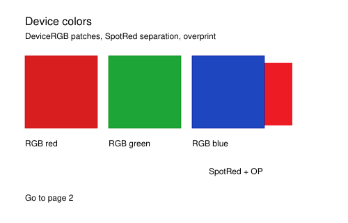

.. include:: ../../header.rst

==============================
19-ColorManagement
==============================

Inspect OutputIntent, spot separations, and overprint, then render device and ICC proofs.

GitHub: `19-ColorManagement <https://github.com/ArtifexSoftware/MuPDF.NET.Examples/tree/main/MuPDF.NET/19-ColorManagement>`_ in `MuPDF.NET.Examples <https://github.com/ArtifexSoftware/MuPDF.NET.Examples>`_.

``color-managed.pdf`` is a 2-page fixture: RGB patches, a ``SpotRed`` separation with overprint, an OutputIntent (``Proof.icc``), a TOC, and a go-to link. Display/proof profiles are ``NULL.icc`` and ``Proof.icc``.

.. code-block:: cs

    using MuPDF.NET;
    using mupdf;

    using (var document = Document.Open(@"D:\color-managed.pdf"))
    using (Page page = document[0])
    {
        Viewing(document, page, outputDir);
        DeviceColorspaces(page, outputDir);
        ObjectInspection(document);
        ZoomAndNavigation(document, page, outputDir);
        ...
    }

API: :meth:`Document.Open`.

Render page 1 as a viewer pixmap
~~~~~~~~~~~~~~~~~~~~~~~~~~~~~~~~~~~~~~~~~~~~~~~~~~~~~~~~~~~~~~~~~~~~~~

.. code-block:: cs

    /// 
Render page 1 as a viewer pixmap

    static void Viewing(Document document, Page page, string outputDir)
    {
        Console.WriteLine("--- viewing ---");
        using (Pixmap viewer = page.GetPixmap(dpi: 144, cs: Colorspace.Rgb, alpha: false))
        {
            viewer.Save(Path.Combine(outputDir, "viewer-page-1-144dpi.png"));
            Console.WriteLine($"viewer pages={document.PageCount} size={viewer.W}x{viewer.H} n={viewer.N}");
        }
    }

API: :meth:`Page.GetPixmap`, :meth:`Pixmap.Save`.

Result:

.. literalinclude:: color-report.txt
   :language: text
   :lines: 1-2

Render device RGB, Gray, and CMYK
~~~~~~~~~~~~~~~~~~~~~~~~~~~~~~~~~~~~~~~~~~~~~~~~~~~~~~~~~~~~~~~~~~~~~~

.. code-block:: cs

    /// 
Render device RGB, Gray, and CMYK

    static void DeviceColorspaces(Page page, string outputDir)
    {
        Console.WriteLine("--- device colorspaces ---");
        using (Pixmap rgb = page.GetPixmap(dpi: 96, cs: Colorspace.Rgb))
        {
            rgb.Save(Path.Combine(outputDir, "device-rgb.png"));
            Console.WriteLine($"device-rgb n={rgb.N} cs={rgb.ColorSpace.Name}");
        }
        using (Pixmap gray = page.GetPixmap(dpi: 96, cs: Colorspace.Gray))
        {
            gray.Save(Path.Combine(outputDir, "device-gray.png"));
            Console.WriteLine($"device-gray n={gray.N} cs={gray.ColorSpace.Name}");
        }
        using (Pixmap cmyk = page.GetPixmap(dpi: 96, cs: Colorspace.Cmyk))
        {
            cmyk.Save(Path.Combine(outputDir, "device-cmyk.pam"));
            Console.WriteLine($"device-cmyk n={cmyk.N} cs={cmyk.ColorSpace.Name}");
        }
    }

API: :meth:`Page.GetPixmap`, :attr:`Pixmap.ColorSpace`.

Result:

.. literalinclude:: color-report.txt
   :language: text
   :lines: 3-6

Page 1 as DeviceRGB, DeviceGray, and DeviceCMYK (RGB preview of ``device-cmyk.pam``):

.. list-table::
   :header-rows: 1
   :widths: 33 33 34

   * - DeviceRGB
     - DeviceGray
     - DeviceCMYK
   * - .. image:: ../../images/examples-color-device-rgb.png
          :alt: color-managed.pdf page 1 rendered as DeviceRGB
          :width: 240
     - .. image:: ../../images/examples-color-device-gray.png
          :alt: color-managed.pdf page 1 rendered as DeviceGray
          :width: 240
     - .. image:: ../../images/examples-color-device-cmyk.png
          :alt: color-managed.pdf page 1 rendered as DeviceCMYK
          :width: 240

Inspect catalog OutputIntents and xref objects
~~~~~~~~~~~~~~~~~~~~~~~~~~~~~~~~~~~~~~~~~~~~~~~~~~~~~~~~~~~~~~~~~~~~~~

.. code-block:: cs

    /// 
Inspect catalog OutputIntents and xref objects

    static void ObjectInspection(Document document)
    {
        Console.WriteLine("--- object inspection ---");
        var outputIntents = document.XrefGetKey(document.PdfCatalog, "OutputIntents");
        Console.WriteLine($"catalogXref={document.PdfCatalog}");
        Console.WriteLine($"xrefLength={document.XrefLength}");
        Console.WriteLine($"outputIntents.type={outputIntents.type}");
        int objectCount = Math.Max(0, Math.Min(8, document.XrefLength - 1));
        for (int xref = 1; xref <= objectCount; xref++)
        {
            var type = document.XrefGetKey(xref, "Type");
            var subtype = document.XrefGetKey(xref, "Subtype");
            Console.WriteLine($"xref={xref} stream={document.XrefIsStream(xref)} Type={type.value} Subtype={subtype.value}");
        }
    }

API: :meth:`Document.XrefGetKey` (also GetKeyXref), :meth:`Document.GetPdfCatalog` (also GetPdfCatelog), :meth:`Document.GetXrefLength` (also XrefLength), :meth:`Document.XrefIsStream`.

Result:

.. literalinclude:: color-report.txt
   :language: text
   :lines: 7-18

Zoom page 1 and count links and TOC entries
~~~~~~~~~~~~~~~~~~~~~~~~~~~~~~~~~~~~~~~~~~~~~~~~~~~~~~~~~~~~~~~~~~~~~~

.. code-block:: cs

    /// 
Zoom page 1 and count links and TOC entries

    static void ZoomAndNavigation(Document document, Page page, string outputDir)
    {
        Console.WriteLine("--- zoom and navigation ---");
        using (Pixmap zoomed = page.GetPixmap(matrix: new Matrix(2, 2), cs: Colorspace.Rgb))
        {
            zoomed.Save(Path.Combine(outputDir, "zoomed-page-1.png"));
            int links = page.GetLinks().Count;
            int toc = document.GetToc().Count;
            Console.WriteLine($"zoom pages={document.PageCount} links={links} toc={toc} size={zoomed.W}x{zoomed.H}");
        }
    }

API: :meth:`Page.GetPixmap`, :class:`Matrix`, :meth:`Page.GetLinks`, :meth:`Document.GetToc`.

Result:

.. literalinclude:: color-report.txt
   :language: text
   :lines: 19-20

Load display and proof ICC profiles
~~~~~~~~~~~~~~~~~~~~~~~~~~~~~~~~~~~~~~~~~~~~~~~~~~~~~~~~~~~~~~~~~~~~~~

.. code-block:: cs

    /// 
Load display and proof ICC profiles

    static void IccProfiles(string displayProfilePath, string proofProfilePath)
    {
        Console.WriteLine("--- ICC profiles ---");
        using (var display = LoadIccColorspace(displayProfilePath))
            DumpColorspace("display", display);
        using (var proof = LoadIccColorspace(proofProfilePath))
            DumpColorspace("proof", proof);
    }

API: ``LoadIccColorspace``, ``DumpColorspace``.

Result:

.. literalinclude:: color-report.txt
   :language: text
   :lines: 21-29

Render page 1 with the display ICC profile
~~~~~~~~~~~~~~~~~~~~~~~~~~~~~~~~~~~~~~~~~~~~~~~~~~~~~~~~~~~~~~~~~~~~~~

.. code-block:: cs

    /// 
Render page 1 with the display ICC profile

    static void ColorManagedRendering(string inputPath, string displayProfilePath, string outputDir)
    {
        Console.WriteLine("--- color-managed rendering ---");
        RenderIccPage(inputPath, displayProfilePath, null, Path.Combine(outputDir, "display-profile-render.png"));
        Console.WriteLine("display-profile-render=ok");
    }

API: ``RenderIccPage``.

Result:

.. literalinclude:: color-report.txt
   :language: text
   :lines: 30-31

Read the document OutputIntent
~~~~~~~~~~~~~~~~~~~~~~~~~~~~~~~~~~~~~~~~~~~~~~~~~~~~~~~~~~~~~~~~~~~~~~

.. code-block:: cs

    /// 
Read the document OutputIntent

    static void OutputIntent(string inputPath)
    {
        Console.WriteLine("--- Output Intent ---");
        using (var native = new FzDocument(inputPath))
        using (var outputIntent = native.fz_document_output_intent())
        {
            if (outputIntent == null || outputIntent.m_internal_value() == 0)
                Console.WriteLine("outputIntent=none");
            else
                DumpColorspace("outputIntent", outputIntent);
        }
    }

API: :meth:`Document.Open`.

Result:

.. literalinclude:: color-report.txt
   :language: text
   :lines: 32-36

List DeviceN / spot separations
~~~~~~~~~~~~~~~~~~~~~~~~~~~~~~~~~~~~~~~~~~~~~~~~~~~~~~~~~~~~~~~~~~~~~~

.. code-block:: cs

    /// 
List DeviceN / spot separations

    static void DeviceNSeparations(string inputPath, string outputDir)
    {
        Console.WriteLine("--- DeviceN / separations ---");
        using (var native = new FzDocument(inputPath))
        using (var fzPage = native.fz_load_page(0))
        using (var separations = fzPage.fz_page_separations())
        {
            if (separations == null || separations.m_internal_value() == 0)
            {
                Console.WriteLine("separations=none");
            }
            else
            {
                int count = separations.fz_count_separations();
                Console.WriteLine($"separations={count}");
                for (int i = 0; i < count; i++)
                {
                    Console.WriteLine($"sep.{i}={separations.fz_separation_name(i)}");
                    separations.fz_set_separation_behavior(i, fz_separation_behavior.FZ_SEPARATION_COMPOSITE);
                }

                using var matrix = new FzMatrix(1, 0, 0, 1, 0, 0);
                using var rgb = new FzColorspace(FzColorspace.Fixed.Fixed_RGB);
                using var pixmap = fzPage.fz_new_pixmap_from_page_with_separations(matrix, rgb, separations, alpha: 0);
                pixmap.fz_save_pixmap_as_png(Path.Combine(outputDir, "separations-composited.png"));
            }
        }
    }

API: :meth:`Document.Open`, :meth:`Page.GetPixmap`.

Result:

.. literalinclude:: color-report.txt
   :language: text
   :lines: 37-39

``SpotRed`` composited onto RGB:

Detect overprint and set simulation flags
~~~~~~~~~~~~~~~~~~~~~~~~~~~~~~~~~~~~~~~~~~~~~~~~~~~~~~~~~~~~~~~~~~~~~~

.. code-block:: cs

    /// 
Detect overprint and set simulation flags

    static void Overprint(string inputPath)
    {
        Console.WriteLine("--- overprint ---");
        using (var native = new FzDocument(inputPath))
        using (var fzPage = native.fz_load_page(0))
        {
            bool usesOverprint = fzPage.fz_page_uses_overprint() != 0;
            using var parameters = new FzColorParams { op = 1, opm = 1, bp = 1, ri = 1 };
            Console.WriteLine($"usesOverprint={usesOverprint}");
            Console.WriteLine($"sim op={parameters.op} opm={parameters.opm} bp={parameters.bp} ri={parameters.ri}");
        }
    }

API: :meth:`Document.Open`.

Result:

.. literalinclude:: color-report.txt
   :language: text
   :lines: 40-42

Convert CMYK with perceptual vs relative colorimetric intent
~~~~~~~~~~~~~~~~~~~~~~~~~~~~~~~~~~~~~~~~~~~~~~~~~~~~~~~~~~~~~~~~~~~~~~

.. code-block:: cs

    /// 
Convert CMYK with perceptual vs relative colorimetric intent

    static void RenderingIntent(string inputPath, string displayProfilePath, string proofProfilePath, string outputDir)
    {
        Console.WriteLine("--- rendering intent ---");
        using (var native = new FzDocument(inputPath))
        using (var fzPage = native.fz_load_page(0))
        using (var matrix = new FzMatrix(1, 0, 0, 1, 0, 0))
        using (var cmyk = new FzColorspace(FzColorspace.Fixed.Fixed_CMYK))
        using (var display = LoadIccColorspace(displayProfilePath))
        using (var proof = LoadIccColorspace(proofProfilePath))
        using (var defaults = new FzDefaultColorspaces())
        using (var source = fzPage.fz_new_pixmap_from_page(matrix, cmyk, alpha: 0))
        {
            using var perceptualParameters = new FzColorParams { ri = 0, bp = 0, op = 0, opm = 0 };
            using var perceptual = source.fz_convert_pixmap(display, proof, defaults, perceptualParameters, keep_alpha: 0);
            perceptual.fz_save_pixmap_as_png(Path.Combine(outputDir, "rendering-intent-perceptual.png"));

            using var relativeParameters = new FzColorParams { ri = 1, bp = 1, op = 1, opm = 1 };
            using var relative = source.fz_convert_pixmap(display, proof, defaults, relativeParameters, keep_alpha: 0);
            relative.fz_save_pixmap_as_png(Path.Combine(outputDir, "rendering-intent-relative-bpc-overprint.png"));
            Console.WriteLine("renderingIntent perceptual=ok relative=ok");
            Console.WriteLine($"ri={relativeParameters.ri} bp={relativeParameters.bp} op={relativeParameters.op} opm={relativeParameters.opm}");
        }
    }

API: :meth:`Document.Open`, :meth:`Pixmap.Save`.

Result:

.. literalinclude:: color-report.txt
   :language: text
   :lines: 43-45

Perceptual vs relative colorimetric:

.. list-table::
   :header-rows: 1
   :widths: 50 50

   * - Perceptual
     - Relative + BPC + overprint
   * - .. image:: ../../images/examples-color-intent-perceptual.png
          :alt: CMYK converted with perceptual rendering intent
          :width: 360
     - .. image:: ../../images/examples-color-intent-relative.png
          :alt: CMYK converted with relative colorimetric intent
          :width: 360

Count pages with OutputIntent, overprint, and separations
~~~~~~~~~~~~~~~~~~~~~~~~~~~~~~~~~~~~~~~~~~~~~~~~~~~~~~~~~~~~~~~~~~~~~~

.. code-block:: cs

    /// 
Count pages with OutputIntent, overprint, and separations

    static void Prepress(string inputPath)
    {
        Console.WriteLine("--- prepress ---");
        using (var native = new FzDocument(inputPath))
        using (var outputIntent = native.fz_document_output_intent())
        {
            bool hasOutputIntent = outputIntent != null && outputIntent.m_internal_value() != 0;
            int pagesWithOverprint = 0;
            int pagesWithSeparations = 0;
            int pageCount = native.fz_count_pages();
            for (int pageNumber = 0; pageNumber < pageCount; pageNumber++)
            {
                using var fzPage = native.fz_load_page(pageNumber);
                if (fzPage.fz_page_uses_overprint() != 0)
                    pagesWithOverprint++;
                using var separations = fzPage.fz_page_separations();
                if (separations != null
                    && separations.m_internal_value() != 0
                    && separations.fz_count_separations() > 0)
                    pagesWithSeparations++;
            }
            Console.WriteLine($"prepress outputIntent={hasOutputIntent} overprintPages={pagesWithOverprint} separationPages={pagesWithSeparations} pageCount={pageCount}");
        }
    }

API: :meth:`Document.Open`.

Result:

.. literalinclude:: color-report.txt
   :language: text
   :lines: 46-47

Soft-proof page 1 with display and proof ICC profiles
~~~~~~~~~~~~~~~~~~~~~~~~~~~~~~~~~~~~~~~~~~~~~~~~~~~~~~~~~~~~~~~~~~~~~~

.. code-block:: cs

    /// 
Soft-proof page 1 with display and proof ICC profiles

    static void IccSoftProof(string inputPath, string displayProfilePath, string proofProfilePath, string outputDir)
    {
        Console.WriteLine("--- ICC soft proof ---");
        mupdf.mupdf.fz_enable_icc();
        RenderIccPage(inputPath, displayProfilePath, proofProfilePath, Path.Combine(outputDir, "soft-proof.png"));
        Console.WriteLine("soft-proof=ok");
    }

API: :meth:`Document.Open`, :meth:`Page.GetPixmap`, :meth:`Pixmap.Save`.

Result:

.. literalinclude:: color-report.txt
   :language: text
   :lines: 48-49

Render a page through display and optional proof ICC profiles
~~~~~~~~~~~~~~~~~~~~~~~~~~~~~~~~~~~~~~~~~~~~~~~~~~~~~~~~~~~~~~~~~~~~~~

.. code-block:: cs

    /// 
Render a page through display and optional proof ICC profiles

    static void RenderIccPage(string inputPath, string displayProfilePath, string? proofProfilePath, string outputPath)
    {
        using var document = new FzDocument(inputPath);
        using var page = document.fz_load_page(0);
        using var display = LoadIccColorspace(displayProfilePath);
        using var proof = proofProfilePath == null ? null : LoadIccColorspace(proofProfilePath);
        using var pageBounds = page.fz_bound_page();
        using var transform = new FzMatrix(2, 0, 0, 2, 0, 0);
        using var transformedBounds = new FzRect(pageBounds, transform);
        using var pixelBounds = new FzIrect(transformedBounds);
        using var noSeparations = new FzSeparations(0);
        using var pixmap = display.fz_new_pixmap_with_bbox(pixelBounds, noSeparations, alpha: 0);
        pixmap.fz_clear_pixmap_with_value(255);
        using var device = proof == null
            ? new FzDevice(transform, pixmap, pixelBounds)
            : new FzDevice(transform, pixmap, pixelBounds, proof);
        using var identity = new FzMatrix(1, 0, 0, 1, 0, 0);
        using var cookie = new FzCookie();
        page.fz_run_page(device, identity, cookie);
        pixmap.fz_save_pixmap_as_png(outputPath);
    }

API: :meth:`Document.Open`, :meth:`Page.GetPixmap`, :meth:`Pixmap.Save`.

Load an ICC profile as a MuPDF colorspace
~~~~~~~~~~~~~~~~~~~~~~~~~~~~~~~~~~~~~~~~~~~~~~~~~~~~~~~~~~~~~~~~~~~~~~

.. code-block:: cs

    /// 
Load an ICC profile as a MuPDF colorspace

    static FzColorspace LoadIccColorspace(string profilePath)
    {
        using var profile = new FzBuffer(profilePath);
        return new FzColorspace((SWIGTYPE_fz_colorspace_type)0, flags: 0, name: Path.GetFileName(profilePath), profile);
    }

API: :class:`ColorSpace`.

Print colorspace name, channel count, and colorants
~~~~~~~~~~~~~~~~~~~~~~~~~~~~~~~~~~~~~~~~~~~~~~~~~~~~~~~~~~~~~~~~~~~~~~

.. code-block:: cs

    /// 
Print colorspace name, channel count, and colorants

    static void DumpColorspace(string label, FzColorspace colorspace)
    {
        Console.WriteLine($"{label} name={colorspace.fz_colorspace_name()} n={colorspace.fz_colorspace_n()} icc={colorspace.fz_colorspace_is_icc() != 0} deviceN={colorspace.fz_colorspace_is_device_n() != 0}");
        for (int i = 0; i < colorspace.fz_colorspace_n(); i++)
            Console.WriteLine($"{label}.c{i}={colorspace.fz_colorspace_colorant(i)}");
    }

API: :attr:`ColorSpace.Name`, :attr:`ColorSpace.N`.

.. include:: ../../footer.rst
