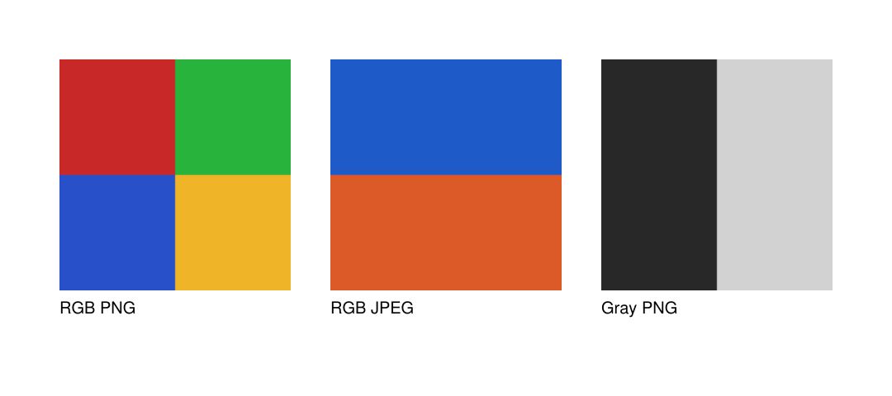

.. include:: ../../header.rst

==============================
21-ExtractImages
==============================

List images on a page and write each embedded stream to disk with :meth:`Document.ExtractImage`.

GitHub: `21-ExtractImages <https://github.com/ArtifexSoftware/MuPDF.NET.Examples/tree/main/MuPDF.NET/21-ExtractImages>`_ in `MuPDF.NET.Examples <https://github.com/ArtifexSoftware/MuPDF.NET.Examples>`_.

``extract-images.pdf`` is a one-page fixture with three rasters (color PNG, color JPEG, gray PNG). ``ExtractImage`` keeps the original format, so the JPEG stays JPEG instead of being converted to PNG.

.. code-block:: cs

    /// 
List images on page 1 and write each embedded image stream to disk

    static void ExtractImages(string inputPath, string outputDir)
    {
        using (var doc = Document.Open(inputPath))
        using (Page page = doc[0])
        {
            // GetImages(full: true) returns xref + colorspace / filter metadata.
            List<Entry> images = page.GetImages(full: true);
            Console.WriteLine($"imageCount={images.Count}");

            int index = 0;
            foreach (Entry entry in images.OrderBy(e => e.Xref))
            {
                ImageInfo extracted = doc.ExtractImage(entry.Xref);
                string ext = string.IsNullOrWhiteSpace(extracted.Ext) ? "bin" : extracted.Ext;
                byte[] data = extracted.Image ?? Array.Empty<byte>();
                string fileName = $"img-{index:D2}-xref{entry.Xref}.{ext}";
                File.WriteAllBytes(Path.Combine(outputDir, fileName), data);

                string sha = Convert.ToHexString(SHA256.HashData(data)).ToLowerInvariant();
                Console.WriteLine($"file={fileName} xref={entry.Xref} ext={ext} w={extracted.Width:0} h={extracted.Height:0} n={extracted.ColorSpace} bytes={data.Length} sha={sha}");
                index++;
            }
        }
    }

API: :meth:`Document.Open`, :meth:`Page.GetImages`, :meth:`Document.ExtractImage`.

Result of ``ExtractImages``:

.. literalinclude:: extract-images.txt
   :language: text

``extract-images.pdf`` page 1:

Extracted files (PNG, JPEG, PNG):

.. list-table::
   :header-rows: 1
   :widths: 33 33 34

   * - img-00-xref5.png
     - img-01-xref11.jpeg
     - img-02-xref14.png
   * - .. image:: ../../images/examples-extract-img-00.png
          :alt: extracted RGB PNG
          :width: 160
     - .. image:: ../../images/examples-extract-img-01.jpeg
          :alt: extracted RGB JPEG
          :width: 160
     - .. image:: ../../images/examples-extract-img-02.png
          :alt: extracted gray PNG
          :width: 160

.. include:: ../../footer.rst
