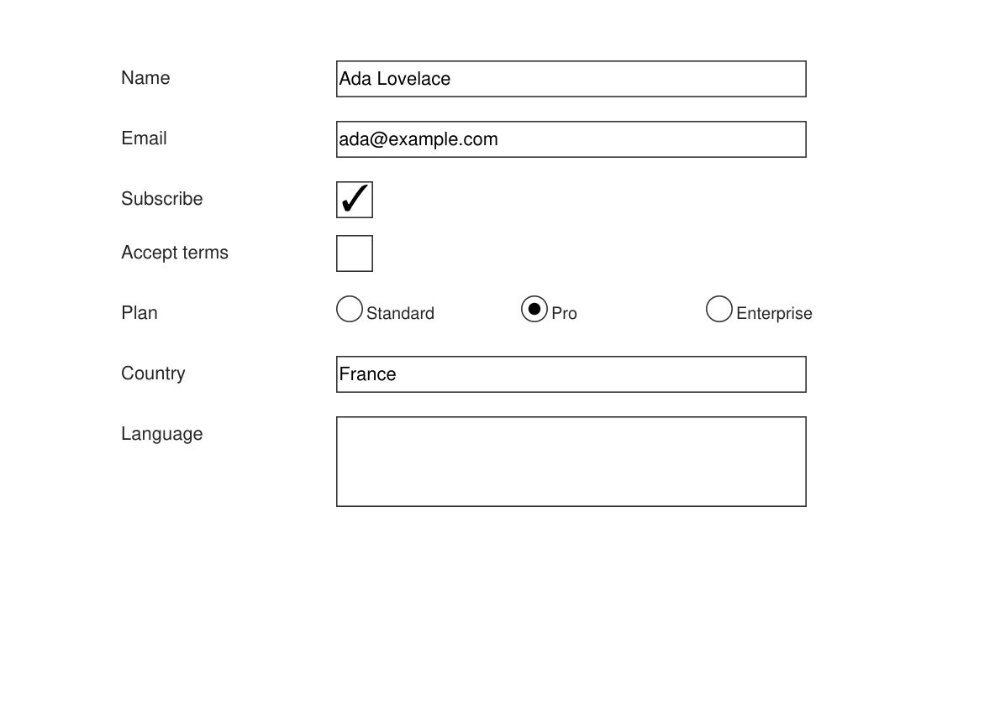

.. include:: ../../header.rst

==============================
39-GetKeyValues
==============================

Extract AcroForm field names and values with ``Utils.GetKeyValues``.

GitHub: `39-GetKeyValues <https://github.com/ArtifexSoftware/MuPDF.NET.Examples/tree/main/MuPDF.NET/39-GetKeyValues>`_ in `MuPDF.NET.Examples <https://github.com/ArtifexSoftware/MuPDF.NET.Examples>`_.

``widgets.pdf`` is the same one-page form as :doc:`08-FormWidgets </examples/widgets/index>` (text, checkbox, radio, combo, list). ``Utils.GetKeyValues`` returns one dictionary entry per field name. The listing is a table with columns ``name``, ``field_value``, ``pages`` (0-based page indices), and ``terminal``. Radio buttons collapse to a single ``plan`` value (``Pro``). ``includeXrefs`` is ``false`` so widget xref numbers are omitted (they change if the PDF is rebuilt). The listing is UTF-8 without a BOM.

To **list each widget instance** (name, type, value) on a page, see :doc:`08-FormWidgets </examples/widgets/index>`.

.. code-block:: cs

    /// 
Extract AcroForm field names and values via Utils.GetKeyValues

    static void GetKeyValues(string inputPath, string outputPath)
    {
        // includeXrefs:false omits widget xref numbers (they change if the PDF is rebuilt).
        Dictionary<string, Dictionary<string, object>> fields =
            Utils.GetKeyValues(inputPath, includeXrefs: false);

        string[] headers = { "name", "field_value", "pages", "terminal" };
        var rows = new List<string[]>();
        foreach (string name in fields.Keys.OrderBy(k => k, StringComparer.Ordinal))
        {
            Dictionary<string, object> info = fields[name];
            rows.Add(new[]
            {
                name,
                FormatValue(info.GetValueOrDefault("field_value")),
                FormatValue(info.GetValueOrDefault("pages")),
                FormatValue(info.GetValueOrDefault("terminal")),
            });
        }

        int[] widths = new int[headers.Length];
        for (int c = 0; c < headers.Length; c++)
        {
            int w = headers[c].Length;
            foreach (string[] row in rows)
                w = Math.Max(w, row[c].Length);
            widths[c] = w;
        }

        var listing = new StringBuilder();
        listing.AppendLine($"fieldCount={fields.Count}");
        listing.AppendLine(FormatRow(headers, widths));
        listing.AppendLine(string.Join("  ", widths.Select(w => new string('-', w))));
        foreach (string[] row in rows)
            listing.AppendLine(FormatRow(row, widths));

        string text = listing.ToString();
        File.WriteAllText(outputPath, text, new UTF8Encoding(encoderShouldEmitUTF8Identifier: false));
        Console.Write(text);
    }

    static string FormatRow(string[] cells, int[] widths) =>
        string.Join("  ", cells.Select((cell, i) => cell.PadRight(widths[i])));

    static string FormatValue(object? value)
    {
        if (value == null)
            return "";
        if (value is List<int> pages)
            return "[" + string.Join(",", pages) + "]";
        if (value is bool flag)
            return flag ? "True" : "False";
        string s = value.ToString() ?? "";
        return s.Replace('\t', ' ').Replace('\n', ' ').Replace('\r', ' ');
    }

API: :meth:`Utils.GetKeyValues`.

``widgets.pdf``:

Listing written to ``keyvalues.txt``:

.. literalinclude:: keyvalues.txt
   :language: text

.. include:: ../../footer.rst
