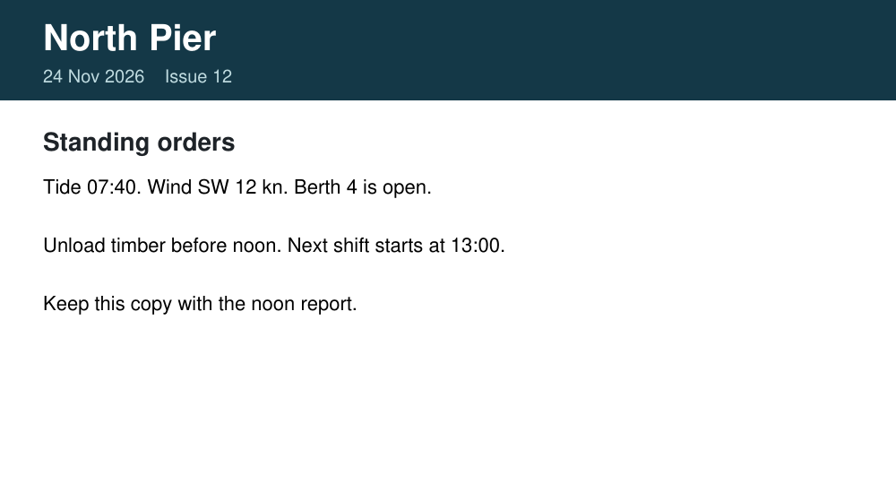
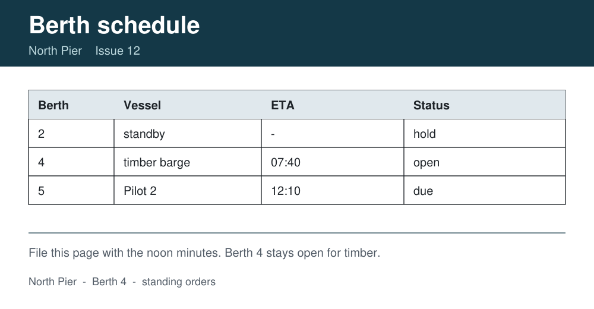

.. include:: ../../header.rst

==============================
38-LlamaMarkdownReader
==============================

Load one LlamaIndex document per page with :meth:`Utils.LlamaMarkdownReader`.

GitHub: `38-LlamaMarkdownReader <https://github.com/ArtifexSoftware/MuPDF.NET.Examples/tree/main/MuPDF.NET/38-LlamaMarkdownReader>`_ in `MuPDF.NET.Examples <https://github.com/ArtifexSoftware/MuPDF.NET.Examples>`_.

``llama-pages.pdf`` is a two-page North Pier notice (500×280 standing orders, 500×260 berth schedule). ``MuPDF4LLM.SetLayout(false)`` selects the classic extract path (no layout worker). ``LoadData`` returns one ``LlamaIndexDocument`` per page. ``Text`` is that page's Markdown. ``ExtraInfo`` includes ``page`` (1-based), ``total_pages``, ``file_path``, and PDF metadata. The listing is UTF-8 without a BOM.

``LlamaMarkdownReader(metaFilter)`` rewrites that ExtraInfo. ``LoadData`` also accepts ``extraInfo`` (keys merged into every page) and ``loadKwargs`` (options forwarded to the Markdown extractor, such as ``table_output``).

To **convert a whole PDF to one Markdown string**, see :doc:`32-ToMarkdown </examples/markdown/index>`. For **layout retrieval chunks**, see :doc:`35-ToChunks </examples/chunks/index>`. To **embed chunks and Ask / Search**, see :doc:`41-LoadAi </examples/loadai/index>`.

.. code-block:: cs

    MuPDF4LLM.SetLayout(false);
    LlamaMarkdownReaderDefault(inputPath, outputPath);
    LlamaMarkdownReaderMetaFilter(inputPath);
    LlamaMarkdownReaderExtraInfo(inputPath);
    LlamaMarkdownReaderLoadKwargs(inputPath);

API: :meth:`MuPDF4LLM.SetLayout` (also :meth:`Utils.SetLayout`), :meth:`Utils.LlamaMarkdownReader`, :meth:`PDFMarkdownReader.LoadData`.

Default reader (no parameters)
~~~~~~~~~~~~~~~~~~~~~~~~~~~~~~~~~~~~~~~~~~~~~~~~~~~~~~~~~~~~~~~~~~~~~~

``Utils.LlamaMarkdownReader()`` uses the built-in ExtraInfo. ``LoadData(inputPath)`` returns one document per page.

.. code-block:: cs

    /// 
Load LlamaIndex-style documents (one per page) via Utils.LlamaMarkdownReader

    static void LlamaMarkdownReaderDefault(string inputPath, string outputPath)
    {
        // Reader wraps ToMarkdown per page and fills ExtraInfo (page, total_pages, metadata).
        var reader = Utils.LlamaMarkdownReader();
        var docs = reader.LoadData(inputPath);

        var listing = new StringBuilder();
        listing.AppendLine($"docCount={docs.Count}");
        listing.AppendLine($"layoutEnabled={MuPDF4LLM.LayoutEnabled}");
        foreach (var d in docs)
        {
            object? page = null;
            object? total = null;
            d.ExtraInfo?.TryGetValue("page", out page);
            d.ExtraInfo?.TryGetValue("total_pages", out total);
            listing.AppendLine();
            listing.AppendLine($"--- page {page} / {total} ---");
            listing.AppendLine(d.Text ?? "");
        }

        string text = listing.ToString();
        File.WriteAllText(outputPath, text, new UTF8Encoding(encoderShouldEmitUTF8Identifier: false));
        Console.Write(text);
    }

API: :meth:`Utils.LlamaMarkdownReader`, :meth:`PDFMarkdownReader.LoadData`, :attr:`LlamaIndexDocument.Text`, :attr:`LlamaIndexDocument.ExtraInfo`.

``llama-pages.pdf`` page 1:

``llama-pages.pdf`` page 2:

Listing written to ``llama-docs.txt``:

.. literalinclude:: llama-docs.txt
   :language: text

metaFilter — rewrite ExtraInfo
~~~~~~~~~~~~~~~~~~~~~~~~~~~~~~~~~~~~~~~~~~~~~~~~~~~~~~~~~~~~~~~~~~~~~~

``metaFilter`` is the parameter of ``Utils.LlamaMarkdownReader``. It runs after built-in keys are filled. Return the dictionary you want on each ``LlamaIndexDocument.ExtraInfo``. This sample drops ``file_path`` and adds ``yard``.

.. code-block:: cs

    /// 
Rewrite ExtraInfo with the metaFilter callback

    static void LlamaMarkdownReaderMetaFilter(string inputPath)
    {
        // metaFilter runs after built-in keys (page, total_pages, file_path, PDF metadata).
        var reader = Utils.LlamaMarkdownReader(metaFilter: extra =>
        {
            extra.Remove("file_path");
            extra["yard"] = "North Pier";
            return extra;
        });
        var docs = reader.LoadData(inputPath);

        object? page = null;
        object? yard = null;
        docs[0].ExtraInfo?.TryGetValue("page", out page);
        docs[0].ExtraInfo?.TryGetValue("yard", out yard);
        bool hasFilePath = docs[0].ExtraInfo != null && docs[0].ExtraInfo.ContainsKey("file_path");
        Console.WriteLine("--- metaFilter ---");
        Console.WriteLine($"page={page} yard={yard} hasFilePath={hasFilePath}");
    }

API: :meth:`Utils.LlamaMarkdownReader`, :attr:`LlamaIndexDocument.ExtraInfo`.

Result:

.. literalinclude:: metafilter.txt
   :language: text

extraInfo — merge your own keys
~~~~~~~~~~~~~~~~~~~~~~~~~~~~~~~~~~~~~~~~~~~~~~~~~~~~~~~~~~~~~~~~~~~~~~

``LoadData(inputPath, extraInfo)`` copies your dictionary onto every page, then adds ``page``, ``total_pages``, ``file_path``, and PDF metadata.

.. code-block:: cs

    /// 
Merge your own keys into every page ExtraInfo

    static void LlamaMarkdownReaderExtraInfo(string inputPath)
    {
        var extraInfo = new Dictionary<string, object>
        {
            ["yard"] = "North Pier",
            ["issue"] = 12,
        };
        var reader = Utils.LlamaMarkdownReader();
        var docs = reader.LoadData(inputPath, extraInfo);

        object? yard = null;
        object? issue = null;
        docs[0].ExtraInfo?.TryGetValue("yard", out yard);
        docs[0].ExtraInfo?.TryGetValue("issue", out issue);
        Console.WriteLine("--- extraInfo ---");
        Console.WriteLine($"yard={yard} issue={issue}");
    }

API: :meth:`PDFMarkdownReader.LoadData`, :attr:`LlamaIndexDocument.ExtraInfo`.

Result:

.. literalinclude:: extrainfo.txt
   :language: text

loadKwargs — options for the Markdown extractor
~~~~~~~~~~~~~~~~~~~~~~~~~~~~~~~~~~~~~~~~~~~~~~~~~~~~~~~~~~~~~~~~~~~~~~

``LoadData(inputPath, loadKwargs: loadKwargs)`` forwards keys such as ``table_output`` and ``show_progress`` to the classic extractor (``MuPDF4LLM.SetLayout(false)``). ``table_output`` is ``markdown`` (default) or ``html``. Page 2 of ``llama-pages.pdf`` is a berth table.

.. code-block:: cs

    /// 
Forward loadKwargs to the Markdown extractor

    static void LlamaMarkdownReaderLoadKwargs(string inputPath)
    {
        // table_output: "markdown" (default) or "html". Used on the classic extract path.
        var loadKwargs = new Dictionary<string, object>
        {
            ["table_output"] = "html",
            ["show_progress"] = false,
        };
        var reader = Utils.LlamaMarkdownReader();
        var docs = reader.LoadData(inputPath, loadKwargs: loadKwargs);

        string page2 = docs[1].Text ?? "";
        bool htmlTable = page2.Contains("<table", StringComparison.OrdinalIgnoreCase);
        Console.WriteLine("--- loadKwargs ---");
        Console.WriteLine($"table_output=html htmlTable={htmlTable}");
        foreach (string line in page2.Replace("\r\n", "\n").Split('\n'))
        {
            if (line.Contains("<table", StringComparison.OrdinalIgnoreCase)
                || line.Contains("<tr", StringComparison.OrdinalIgnoreCase)
                || line.Contains("</table", StringComparison.OrdinalIgnoreCase))
                Console.WriteLine(line);
        }
    }

API: :meth:`PDFMarkdownReader.LoadData`, :attr:`LlamaIndexDocument.Text`.

Result:

.. literalinclude:: loadkwargs.txt
   :language: text

.. include:: ../../footer.rst
