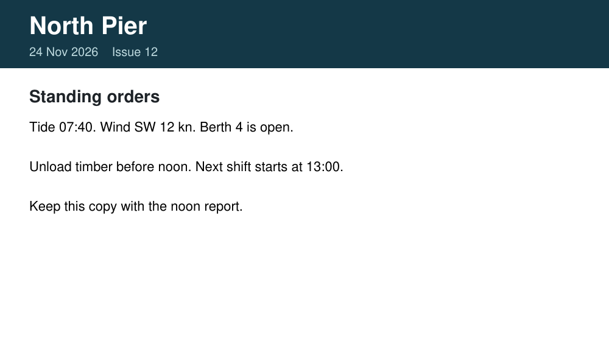
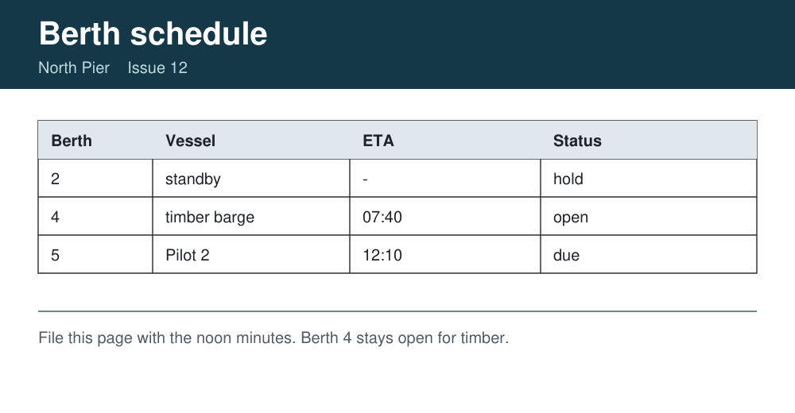

.. include:: ../../header.rst

==============================
41-LoadAi
==============================

Index PDFs with :meth:`Utils.LoadAiAsync`, then Ask, Summarize, Search, Add, and Remove on :class:`AiDocumentCollection`.

GitHub: `41-LoadAi <https://github.com/ArtifexSoftware/MuPDF.NET.Examples/tree/main/MuPDF.NET/41-LoadAi>`_ in `MuPDF.NET.Examples <https://github.com/ArtifexSoftware/MuPDF.NET.Examples>`_.

``pier-orders.pdf`` (500×280 standing orders) and ``pier-schedule.pdf`` (500×260 berth table) are two North Pier notices. ``MuPDF4LLM.SetLayout(false)`` selects the classic extract path (no layout worker). ``CreateDevelopmentAiOptions`` uses hash embeddings and an in-memory index. ``ExampleRagChatClient`` is a local ``IChatClient`` so this sample needs no API keys. Swap that client for OpenAI, Azure, or Ollama — the MuPDF.NET extract/RAG API stays the same. ``LoadAiAsync`` returns an ``AiDocumentCollection``. The listing is UTF-8 without a BOM.

To **split a PDF into layout chunks** without embed/ask, see :doc:`35-ToChunks </examples/chunks/index>`. For **one LlamaIndex document per page**, see :doc:`38-LlamaMarkdownReader </examples/llamareader/index>`. To **convert a PDF to Markdown**, see :doc:`32-ToMarkdown </examples/markdown/index>`.

.. code-block:: cs

    MuPDF4LLM.SetLayout(false);
    await LoadAiAskSearch(new[] { ordersPath, schedulePath }, outputPath);
    await LoadAiAddDocuments(ordersPath, schedulePath);
    await LoadAiRemoveDocument(ordersPath, schedulePath);
    await LoadAiFilterSource(ordersPath, schedulePath);

API: :meth:`MuPDF4LLM.SetLayout` (also :meth:`Utils.SetLayout`), :meth:`Utils.CreateDevelopmentAiOptions`, :meth:`Utils.LoadAiAsync`, :class:`AiDocumentCollection`.

Ask, Summarize, and Search
~~~~~~~~~~~~~~~~~~~~~~~~~~~~~~~~~~~~~~~~~~~~~~~~~~~~~~~~~~~~~~~~~~~~~~

``AskAsync`` answers from retrieved excerpts. ``SummarizeAsync`` summarizes one source file by name. ``SearchAsync`` ranks chunks (no chat).

.. code-block:: cs

    /// 
Index PDFs with Utils.LoadAiAsync, then Ask / Summarize / Search

    static async Task LoadAiAskSearch(string[] inputPaths, string outputPath)
    {
        // Hash embeddings + in-memory index. Swap ExampleRagChatClient for a real IChatClient.
        var options = Utils.CreateDevelopmentAiOptions(chatClient: new ExampleRagChatClient());
        options.UseLayout = false;

        var aiDocs = await Utils.LoadAiAsync(inputPaths, options);

        const string question = "Which berth is open for the timber barge?";
        const string searchQuery = "timber barge";

        string answer = await aiDocs.AskAsync(question);
        string summary = await aiDocs.SummarizeAsync("pier-orders.pdf");
        var hits = await aiDocs.SearchAsync(searchQuery, topK: 3);

        var listing = new StringBuilder();
        listing.AppendLine($"chunkCount={aiDocs.ChunkCount}");
        listing.AppendLine($"layoutEnabled={MuPDF4LLM.LayoutEnabled}");
        foreach (string source in aiDocs.SourceFiles.OrderBy(s => s, StringComparer.Ordinal))
            listing.AppendLine($"source={source}");

        listing.AppendLine();
        listing.AppendLine("--- ask ---");
        listing.AppendLine($"question={question}");
        listing.AppendLine(answer.Trim());

        listing.AppendLine();
        listing.AppendLine("--- summarize ---");
        listing.AppendLine("source=pier-orders.pdf");
        listing.AppendLine(summary.Trim());

        listing.AppendLine();
        listing.AppendLine("--- search ---");
        listing.AppendLine($"query={searchQuery}");
        listing.AppendLine("rank  source              page");
        listing.AppendLine("----  ------------------  ----");
        for (int i = 0; i < hits.Count; i++)
        {
            var hit = hits[i];
            listing.AppendLine(
                $"{i + 1,-4}  {hit.Chunk.SourceFileName,-18}  {hit.Chunk.PageNumber}");
        }

        string text = listing.ToString();
        File.WriteAllText(outputPath, text, new UTF8Encoding(encoderShouldEmitUTF8Identifier: false));
        Console.Write(text);
    }

API: :meth:`AiDocumentCollection.AskAsync`, :meth:`AiDocumentCollection.SummarizeAsync`, :meth:`AiDocumentCollection.SearchAsync`, :attr:`AiDocumentCollection.ChunkCount`, :attr:`AiDocumentCollection.SourceFiles`.

``pier-orders.pdf``:

``pier-schedule.pdf``:

Listing written to ``load-ai.txt``:

.. literalinclude:: load-ai.txt
   :language: text

AddDocumentsAsync — index another PDF
~~~~~~~~~~~~~~~~~~~~~~~~~~~~~~~~~~~~~~~~~~~~~~~~~~~~~~~~~~~~~~~~~~~~~~

Load ``pier-orders.pdf`` first, then ``AddDocumentsAsync`` upserts ``pier-schedule.pdf``. Chunks from a file that is already indexed are replaced.

.. code-block:: cs

    /// 
Index more PDFs with AddDocumentsAsync

    static async Task LoadAiAddDocuments(string ordersPath, string schedulePath)
    {
        var options = Utils.CreateDevelopmentAiOptions(chatClient: new ExampleRagChatClient());
        options.UseLayout = false;

        var aiDocs = await Utils.LoadAiAsync(new[] { ordersPath }, options);
        Console.WriteLine("--- add ---");
        Console.WriteLine($"before chunkCount={aiDocs.ChunkCount} sources={string.Join(",", aiDocs.SourceFiles.OrderBy(s => s, StringComparer.Ordinal))}");
        await aiDocs.AddDocumentsAsync(new[] { schedulePath });
        Console.WriteLine($"after chunkCount={aiDocs.ChunkCount} sources={string.Join(",", aiDocs.SourceFiles.OrderBy(s => s, StringComparer.Ordinal))}");
    }

API: :meth:`AiDocumentCollection.AddDocumentsAsync`.

Result:

.. literalinclude:: add.txt
   :language: text

RemoveDocumentAsync — drop one source
~~~~~~~~~~~~~~~~~~~~~~~~~~~~~~~~~~~~~~~~~~~~~~~~~~~~~~~~~~~~~~~~~~~~~~

``RemoveDocumentAsync`` takes a path or file name. After removing ``pier-orders.pdf``, only the schedule chunks remain.

.. code-block:: cs

    /// 
Drop one source PDF with RemoveDocumentAsync

    static async Task LoadAiRemoveDocument(string ordersPath, string schedulePath)
    {
        var options = Utils.CreateDevelopmentAiOptions(chatClient: new ExampleRagChatClient());
        options.UseLayout = false;

        var aiDocs = await Utils.LoadAiAsync(new[] { ordersPath, schedulePath }, options);
        Console.WriteLine("--- remove ---");
        Console.WriteLine($"before chunkCount={aiDocs.ChunkCount} sources={string.Join(",", aiDocs.SourceFiles.OrderBy(s => s, StringComparer.Ordinal))}");
        await aiDocs.RemoveDocumentAsync("pier-orders.pdf");
        Console.WriteLine($"after chunkCount={aiDocs.ChunkCount} sources={string.Join(",", aiDocs.SourceFiles.OrderBy(s => s, StringComparer.Ordinal))}");
    }

API: :meth:`AiDocumentCollection.RemoveDocumentAsync`.

Result:

.. literalinclude:: remove.txt
   :language: text

Filter Ask / Search / Summarize by source
~~~~~~~~~~~~~~~~~~~~~~~~~~~~~~~~~~~~~~~~~~~~~~~~~~~~~~~~~~~~~~~~~~~~~~

``sourceFileName`` limits Ask and Search to one indexed file. ``pageNumber`` (1-based) limits Summarize to that page.

.. code-block:: cs

    /// 
Limit Ask / Search / Summarize to one source file

    static async Task LoadAiFilterSource(string ordersPath, string schedulePath)
    {
        var options = Utils.CreateDevelopmentAiOptions(chatClient: new ExampleRagChatClient());
        options.UseLayout = false;

        var aiDocs = await Utils.LoadAiAsync(new[] { ordersPath, schedulePath }, options);
        const string question = "Which berth is open for the timber barge?";
        var hits = await aiDocs.SearchAsync("timber barge", topK: 3, sourceFileName: "pier-schedule.pdf");
        string answer = await aiDocs.AskAsync(question, sourceFileName: "pier-schedule.pdf");
        string pageSummary = await aiDocs.SummarizeAsync("pier-schedule.pdf", pageNumber: 1);

        Console.WriteLine("--- filter ---");
        Console.WriteLine($"askSource=pier-schedule.pdf");
        Console.WriteLine(answer.Trim());
        Console.WriteLine($"summarizePage=1");
        Console.WriteLine(pageSummary.Trim());
        Console.WriteLine("rank  source              page");
        Console.WriteLine("----  ------------------  ----");
        for (int i = 0; i < hits.Count; i++)
        {
            var hit = hits[i];
            Console.WriteLine(
                $"{i + 1,-4}  {hit.Chunk.SourceFileName,-18}  {hit.Chunk.PageNumber}");
        }
    }

API: :meth:`AiDocumentCollection.AskAsync`, :meth:`AiDocumentCollection.SearchAsync`, :meth:`AiDocumentCollection.SummarizeAsync`.

Result:

.. literalinclude:: filter.txt
   :language: text

Offline chat client
~~~~~~~~~~~~~~~~~~~~~~~~~~~~~~~~~~~~~~~~~~~~~~~~~~~~~~~~~~~~~~~~~~~~~~

Used by every method above so ``dotnet run`` needs no API keys.

.. code-block:: cs

    /// 
Offline IChatClient so the sample runs with no API keys.

    sealed class ExampleRagChatClient : IChatClient
    {
        public ChatClientMetadata Metadata { get; } = new("example-rag");

        public Task<ChatResponse> GetResponseAsync(
            IEnumerable<ChatMessage> messages,
            ChatOptions? options = null,
            CancellationToken cancellationToken = default)
        {
            string system = messages.FirstOrDefault(m => m.Role == ChatRole.System)?.Text ?? "";
            string user = messages.FirstOrDefault(m => m.Role == ChatRole.User)?.Text ?? "";
            bool schedule = user.Contains("pier-schedule", StringComparison.OrdinalIgnoreCase);
            bool summarize = system.Contains("Summarize", StringComparison.OrdinalIgnoreCase);
            string answer = summarize
                ? schedule
                    ? "Development-mode summary (no API keys).\n\n"
                      + "Berth schedule: berth 4 timber barge is open at 07:40. Berth 5 Pilot 2 is due at 12:10."
                    : "Development-mode summary (no API keys).\n\n"
                      + "Standing orders for North Pier: tide 07:40, wind SW 12 kn. Berth 4 is open. Unload timber before noon."
                : schedule
                    ? "Development-mode answer (no API keys).\n\n"
                      + "Berth 4 is open for the timber barge (ETA 07:40)."
                    : "Development-mode answer (no API keys).\n\n"
                      + "Berth 4 is open for the timber barge. Unload timber before noon.";
            return Task.FromResult(new ChatResponse(new ChatMessage(ChatRole.Assistant, answer)));
        }

        public IAsyncEnumerable<ChatResponseUpdate> GetStreamingResponseAsync(
            IEnumerable<ChatMessage> messages,
            ChatOptions? options = null,
            CancellationToken cancellationToken = default) =>
            throw new NotSupportedException();

        public object? GetService(Type serviceType, object? serviceKey = null) => null;

        public void Dispose() { }
    }

.. include:: ../../footer.rst
