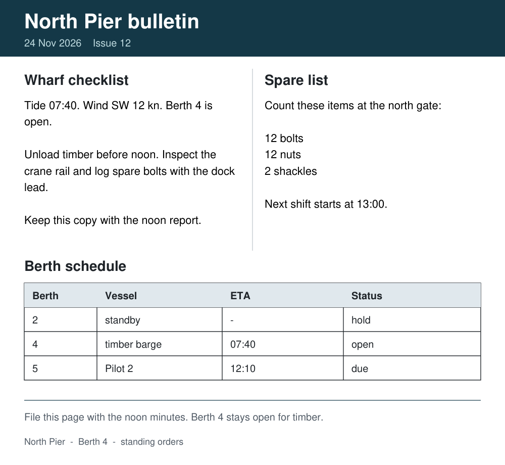

.. include:: ../../header.rst

==============================
32-ToMarkdown
==============================

Convert a PDF to Markdown with ``Document.ToMarkdown``.

GitHub: `32-ToMarkdown <https://github.com/ArtifexSoftware/MuPDF.NET.Examples/tree/main/MuPDF.NET/32-ToMarkdown>`_ in `MuPDF.NET.Examples <https://github.com/ArtifexSoftware/MuPDF.NET.Examples>`_.

``bulletin.pdf`` is a one-page North Pier bulletin (500×460): two-column copy and a ruled berth table. ``MuPDF4LLM.SetLayout(false)`` selects the classic extract path (no layout worker). The 20 pt title becomes ``#``, 14 pt section heads become ``##``, and the berth grid becomes a Markdown table. ``useOcr`` is ``false`` because this PDF is already text. The ``.md`` file is UTF-8 without a BOM.

To **extract plain text** with :meth:`Page.GetText`, see :doc:`04-TextExtractSearch </examples/text/index>`. For a **table as Markdown**, see :doc:`11-Tables </examples/tables/index>`. For **layout JSON** from the same PDF, see :doc:`33-ToJsonLayout </examples/json/index>`. For **layout plain text**, see :doc:`34-ToText </examples/totext/index>`. For **retrieval chunks**, see :doc:`35-ToChunks </examples/chunks/index>`. For **OCR on a scan**, see :doc:`36-Ocr </examples/ocr/index>`. For **one LlamaIndex document per page**, see :doc:`38-LlamaMarkdownReader </examples/llamareader/index>`. To **render Markdown as a PDF**, see :doc:`40-MarkdownToPdf </examples/markdowntopdf/index>`.

.. code-block:: cs

    /// 
Convert a PDF to Markdown (classic extract, layout off)

    static void ToMarkdown(string inputPath, string outputPath)
    {
        // Remember prior layout flag so we restore it for other examples in the same process.
        bool prior = MuPDF4LLM.LayoutEnabled;
        try
        {
            // false = classic extract (no layout worker required).
            MuPDF4LLM.SetLayout(false);

            using var doc = Document.Open(inputPath);
            string markdown = doc.ToMarkdown(showProgress: false, useOcr: false) ?? "";
            File.WriteAllText(outputPath, markdown, new UTF8Encoding(encoderShouldEmitUTF8Identifier: false));
            Console.WriteLine($"pageCount={doc.PageCount}");
            Console.WriteLine($"layoutEnabled={MuPDF4LLM.LayoutEnabled}");
            Console.WriteLine($"charCount={markdown.Length}");
            Console.WriteLine(markdown);
        }
        finally
        {
            MuPDF4LLM.SetLayout(prior);
        }
    }

API: :meth:`Document.Open`, :meth:`MuPDF4LLM.SetLayout` (also :meth:`Utils.SetLayout`), :meth:`Document.ToMarkdown`.

``bulletin.pdf``:

Markdown written to ``to-markdown.md``:

.. literalinclude:: to-markdown.md
   :language: markdown

.. include:: ../../footer.rst
