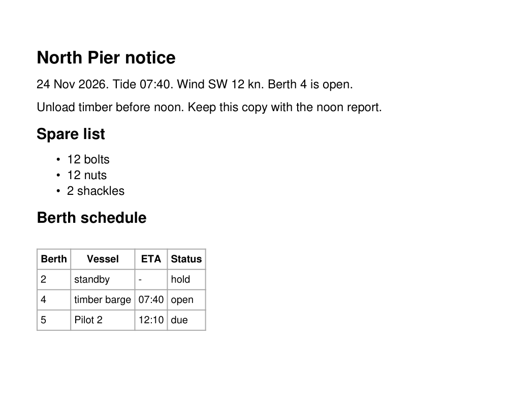

.. include:: ../../header.rst

==============================
40-MarkdownToPdf
==============================

Render a Markdown file to PDF with ``Utils.MarkdownToPdf``.

GitHub: `40-MarkdownToPdf <https://github.com/ArtifexSoftware/MuPDF.NET.Examples/tree/main/MuPDF.NET/40-MarkdownToPdf>`_ in `MuPDF.NET.Examples <https://github.com/ArtifexSoftware/MuPDF.NET.Examples>`_.

``north-pier.md`` is a short North Pier notice (heading, paragraph, list, berth table). ``Utils.MarkdownToPdf`` converts Markdown to HTML and lays it out with Story. ``pageRect`` is 500×400 with 36 pt margins so the page is compact for this image (the API default is A4). When ``outputPath`` is set, the PDF is written to disk and the return value is null. The ``.md`` file is UTF-8 without a BOM.

To **convert a PDF to Markdown**, see :doc:`32-ToMarkdown </examples/markdown/index>`. To **lay out HTML with Story**, see :doc:`06-StoryHtmlBox </examples/story/index>`.

.. code-block:: cs

    /// 
Render a Markdown file to PDF via Utils.MarkdownToPdf (Story)

    static void MarkdownToPdf(string inputPath, string outputPath)
    {
        // Compact page so the Story layout matches the docs image (default is A4).
        var pageRect = new Rect(0, 0, 500, 400);
        float[] margins = { 36, 36, 36, 36 };

        // When outputPath is set, the PDF is written to disk (return value is null).
        Utils.MarkdownToPdf(
            inputPath,
            pageRect: pageRect,
            margins: margins,
            outputPath: outputPath);

        using var doc = Document.Open(outputPath);
        using Page page = doc[0];
        Console.WriteLine($"pageCount={doc.PageCount}");
        Console.WriteLine($"width={page.Rect.Width}");
        Console.WriteLine($"height={page.Rect.Height}");
    }

API: :meth:`Utils.MarkdownToPdf`, :meth:`Document.Open`.

``north-pier.md``:

.. literalinclude:: north-pier.md
   :language: markdown

PDF written to ``north-pier.pdf``:

.. include:: ../../footer.rst
