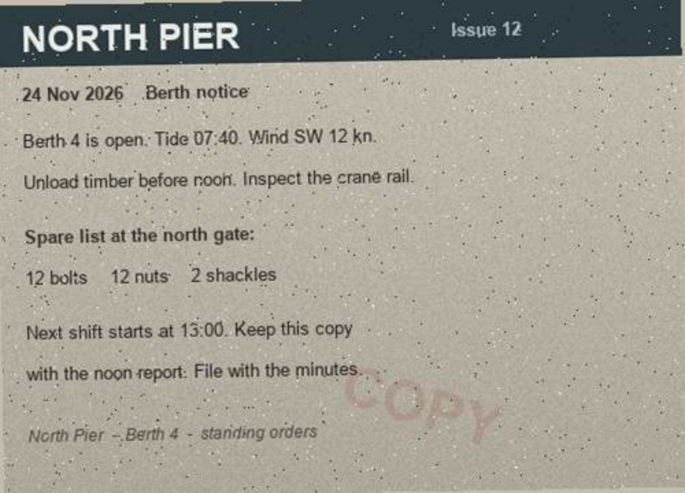

.. include:: ../../header.rst

==============================
36-Ocr
==============================

Compare Markdown with OCR off vs on using ``Document.ToMarkdown``.

GitHub: `36-Ocr <https://github.com/ArtifexSoftware/MuPDF.NET.Examples/tree/main/MuPDF.NET/36-Ocr>`_ in `MuPDF.NET.Examples <https://github.com/ArtifexSoftware/MuPDF.NET.Examples>`_.

``ocr-scan.pdf`` is a one-page image-only copier scan (500×360): cream paper, 1° skew, speckle, a faint COPY stamp, and JPEG quality 68. The page has no text layer: ``Page.GetText`` is empty. ``Utils.UseLayout(true)`` selects the layout path. ``useOcr`` is ``false`` leaves Markdown empty. ``useOcr`` is ``true`` with ``forceOcr`` is ``true`` runs OCR even when the layout heuristic would skip a noisy scan. Open two ``Document`` instances so OCR cannot write text spans onto the off pass. Layout then tags the large title as ``# NORTH PIER`` and splits ``Issue 12``; the body stays one paragraph because RapidOCR merged those lines. Words can still be garbled. Without a layout worker the method prints ``LAYOUT_UNAVAILABLE``; without RapidOCR or Tesseract ``TESSDATA_PREFIX`` it prints ``OCR_UNAVAILABLE``. The ``.md`` files are UTF-8 without a BOM.

To **convert a text PDF to Markdown** with OCR off, see :doc:`32-ToMarkdown </examples/markdown/index>`. To **extract embedded text** with :meth:`Page.GetText`, see :doc:`04-TextExtractSearch </examples/text/index>`. To **write a table as CSV**, see :doc:`37-TablesCsv </examples/tablescsv/index>`.

.. code-block:: cs

    /// 
Compare Markdown with OCR off vs on (requires layout worker and an OCR engine)

    static void Ocr(string inputPath, string outputOffPath, string outputOnPath)
    {
        // Remember prior layout flag so we restore it for other examples in the same process.
        bool prior = Utils.LayoutEnabled;
        try
        {
            // ToMarkdown OCR runs only in layout mode, and only when an engine is registered.
            if (!Utils.LayoutAvailable)
            {
                Console.WriteLine("LAYOUT_UNAVAILABLE");
                return;
            }
            if (!Utils.RapidOcrAvailable && string.IsNullOrEmpty(Utils.TESSDATA_PREFIX))
            {
                Console.WriteLine("OCR_UNAVAILABLE");
                return;
            }

            Utils.UseLayout(true);

            // Image-only page: useOcr false keeps the scan empty.
            using (var docOff = Document.Open(inputPath))
            {
                string mdOff = docOff.ToMarkdown(showProgress: false, useOcr: false) ?? "";
                File.WriteAllText(outputOffPath, mdOff, new UTF8Encoding(encoderShouldEmitUTF8Identifier: false));
                Console.WriteLine($"pageCount={docOff.PageCount}");
                Console.WriteLine($"layoutEnabled={Utils.LayoutEnabled}");
                Console.WriteLine($"ocrOffCharCount={mdOff.Length}");
                Console.WriteLine("=== useOcr false ===");
                Console.WriteLine(mdOff);
            }

            // Separate Document: OCR may write text spans onto the page it processes.
            using (var docOn = Document.Open(inputPath))
            {
                // forceOcr: a copier scan can fail the layout "needs OCR" heuristic.
                string mdOn = docOn.ToMarkdown(showProgress: false, useOcr: true, forceOcr: true) ?? "";
                File.WriteAllText(outputOnPath, mdOn, new UTF8Encoding(encoderShouldEmitUTF8Identifier: false));
                Console.WriteLine($"ocrOnCharCount={mdOn.Length}");
                Console.WriteLine("=== useOcr true ===");
                Console.WriteLine(mdOn);
            }
        }
        finally
        {
            Utils.UseLayout(prior);
        }
    }

API: :meth:`Document.Open`, :attr:`Utils.LayoutAvailable`, :attr:`Utils.RapidOcrAvailable`, :attr:`Utils.TESSDATA_PREFIX`, :meth:`Utils.UseLayout`, :meth:`Document.ToMarkdown`.

``ocr-scan.pdf``:

``ocr-off.md`` is empty (``ocrOffCharCount`` is ``0``).

Markdown written to ``ocr-on.md``:

.. literalinclude:: ocr-on.md
   :language: markdown

.. include:: ../../footer.rst
