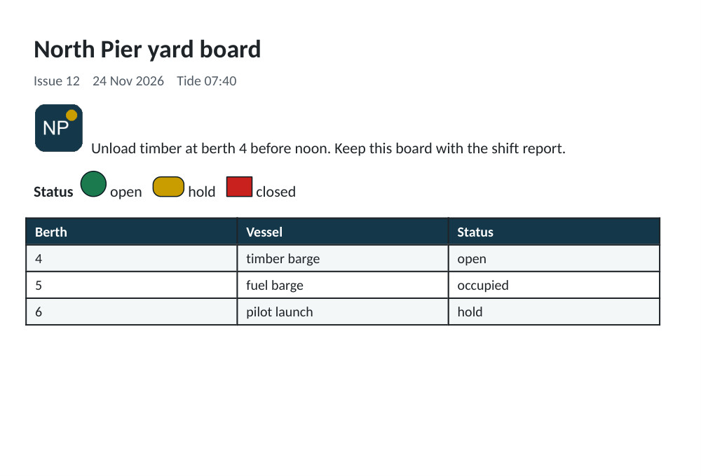

.. include:: ../../header.rst

==============================
04-ExportToMarkdownJson
==============================

Export an Office document to Markdown and JSON with ``MuPDFOffice.ToMarkdown`` and ``MuPDFOffice.ToJson``.

GitHub: `04-ExportToMarkdownJson <https://github.com/ArtifexSoftware/MuPDF.NET.Examples/tree/main/MuPDF.NET.Office/04-ExportToMarkdownJson>`_ in `MuPDF.NET.Examples <https://github.com/ArtifexSoftware/MuPDF.NET.Examples>`_.

``pier-yard.docx`` is the same one-page North Pier yard board as :doc:`03-ExportToPdf </examples/office/exportpdf>` (heading, mark image, status shapes, berth table). Call :meth:`MuPDFOffice.Unlock` first so the Office document handler is registered. Empty / unset ``MUPDF_OFFICE_KEY`` is restricted mode (first 3 pages). The sample never prints the key. ``fontPathAuto`` is ``true``. When the output path is set, ``ToMarkdown`` and ``ToJson`` write the file and return ``null``. ``ToMarkdown`` turns the berth grid into a Markdown table. Full JSON embeds OS font names and glyph metrics, so the listing is page size, block counts, and text only (layout ``box`` and vector ``path`` blocks are counted, not dumped). The listing is UTF-8 without a BOM.

This is the Office export API, not :meth:`Document.ToMarkdown` / :meth:`Document.ToJson`. To **export the same DOCX to PDF**, see :doc:`03-ExportToPdf </examples/office/exportpdf>`. To **convert a PDF to Markdown**, see :doc:`32-ToMarkdown </examples/markdown/index>`. For **layout JSON from a PDF**, see :doc:`33-ToJsonLayout </examples/json/index>`.

.. code-block:: cs

    /// 
Export an Office document to Markdown and JSON

    static void ExportToMarkdownJson(string inputPath, string markdownPath, string jsonPath)
    {
        // Empty / unset MUPDF_OFFICE_KEY = restricted mode (first 3 pages). Never print the key.
        string? key = Environment.GetEnvironmentVariable("MUPDF_OFFICE_KEY")?.Trim();
        if (string.IsNullOrEmpty(key))
            key = null;
        MuPDFOffice.Unlock(key, fontPathAuto: true);

        // When the output path is set, these write the file and return null.
        MuPDFOffice.ToMarkdown(inputPath, markdownPath);
        MuPDFOffice.ToJson(inputPath, jsonPath);

        string markdown = File.ReadAllText(markdownPath);
        string json = File.ReadAllText(jsonPath);

        Console.WriteLine("--- markdown ---");
        Console.Write(markdown);
        if (!markdown.EndsWith('\n'))
            Console.WriteLine();

        // Full JSON embeds OS font names and glyph metrics — dump type + text only.
        Console.WriteLine("--- json ---");
        WriteJsonSummary(json);
    }

    static void WriteJsonSummary(string json)
    {
        using var parsed = JsonDocument.Parse(string.IsNullOrWhiteSpace(json) ? "{}" : json);
        JsonElement root = parsed.RootElement;
        if (!root.TryGetProperty("pages", out JsonElement pages) ||
            pages.ValueKind != JsonValueKind.Array)
        {
            Console.WriteLine("jsonPageCount=0");
            return;
        }

        Console.WriteLine($"jsonPageCount={pages.GetArrayLength()}");
        if (pages.GetArrayLength() > 0)
        {
            JsonElement page = pages[0];
            if (page.TryGetProperty("width", out JsonElement width))
                Console.WriteLine($"jsonPageWidth={FormatNumber(width)}");
            if (page.TryGetProperty("height", out JsonElement height))
                Console.WriteLine($"jsonPageHeight={FormatNumber(height)}");
        }

        int boxCount = 0;
        int pathCount = 0;
        var texts = new List<string>();
        foreach (JsonElement page in pages.EnumerateArray())
        {
            if (!page.TryGetProperty("blocks", out JsonElement blocks) ||
                blocks.ValueKind != JsonValueKind.Array)
                continue;
            foreach (JsonElement block in blocks.EnumerateArray())
            {
                string type = block.TryGetProperty("type", out JsonElement typeEl)
                    ? typeEl.GetString() ?? ""
                    : "";
                if (type == "box")
                {
                    boxCount++;
                    continue;
                }
                if (type == "path")
                {
                    pathCount++;
                    continue;
                }
                string text = "";
                if (block.TryGetProperty("text", out JsonElement textEl))
                    text = CollapseText(textEl.GetString());
                texts.Add(text.Length > 0 ? text : type);
            }
        }
        Console.WriteLine($"jsonBoxCount={boxCount}");
        Console.WriteLine($"jsonPathCount={pathCount}");
        Console.WriteLine($"jsonTextCount={texts.Count}");
        for (int i = 0; i < texts.Count; i++)
            Console.WriteLine($"jsonText{i}={texts[i]}");
    }

    static string FormatNumber(JsonElement el)
    {
        if (el.ValueKind == JsonValueKind.Number && el.TryGetDouble(out double d))
            return d.ToString("0.0", CultureInfo.InvariantCulture);
        return el.ToString();
    }

    static string CollapseText(string? value)
    {
        string s = value ?? "";
        var sb = new StringBuilder(s.Length);
        bool space = false;
        foreach (char c in s)
        {
            if (char.IsWhiteSpace(c))
            {
                space = true;
                continue;
            }
            if (space && sb.Length > 0)
                sb.Append(' ');
            space = false;
            sb.Append(c);
        }
        return sb.ToString();
    }

API: :meth:`MuPDFOffice.Unlock`, :meth:`MuPDFOffice.ToMarkdown`, :meth:`MuPDFOffice.ToJson`.

``pier-yard.docx``:

Markdown written to ``pier-yard.md``:

.. literalinclude:: pier-yard.md
   :language: markdown

JSON summary (not the full file):

.. literalinclude:: json-summary.txt
   :language: text

.. include:: ../../footer.rst
