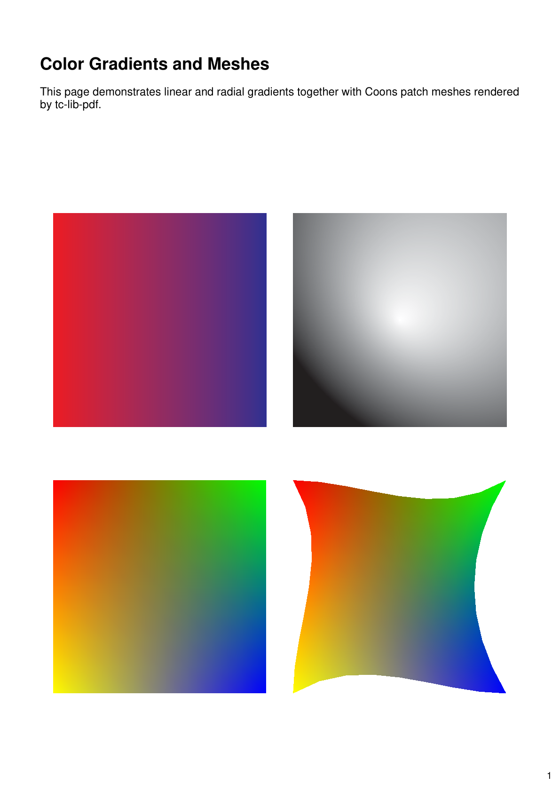

.. include:: ../../header.rst

==============================
03-RenderPixmap
==============================

Render page 1 of a PDF to a PNG pixmap at 2× zoom.

GitHub: `03-RenderPixmap <https://github.com/ArtifexSoftware/MuPDF.NET.Examples/tree/main/MuPDF.NET/03-RenderPixmap>`_ in `MuPDF.NET.Examples <https://github.com/ArtifexSoftware/MuPDF.NET.Examples>`_.

``color-shapes.pdf`` is a one-page RGB board (hue bar, swatches, circle, round rect, triangle). This method renders page 0. ``Matrix(2, 2)`` is about 144 dpi from a 72 dpi page.

To **render several PDFs in parallel**, see :doc:`31-ParallelPixmap </examples/parallel/index>`.

.. code-block:: cs

    /// 
Render page 1 to a PNG pixmap at 2× zoom

    static void RenderPixmap(string inputPath, string outputPath)
    {
        // Open document and first page.
        using (var doc = Document.Open(inputPath))
        using (Page page = doc[0])
        // Matrix(2,2) = 2× resolution (about 144 dpi from a 72 dpi page).
        using (Pixmap pix = page.GetPixmap(matrix: new Matrix(2, 2)))
        {
            // Save the rendered bitmap as PNG.
            pix.Save(outputPath);
        }
    }

API: :meth:`Document.Open`, :meth:`Page.GetPixmap`, :meth:`Pixmap.Save`.

Result of ``page-1.png``:

.. include:: ../../footer.rst
