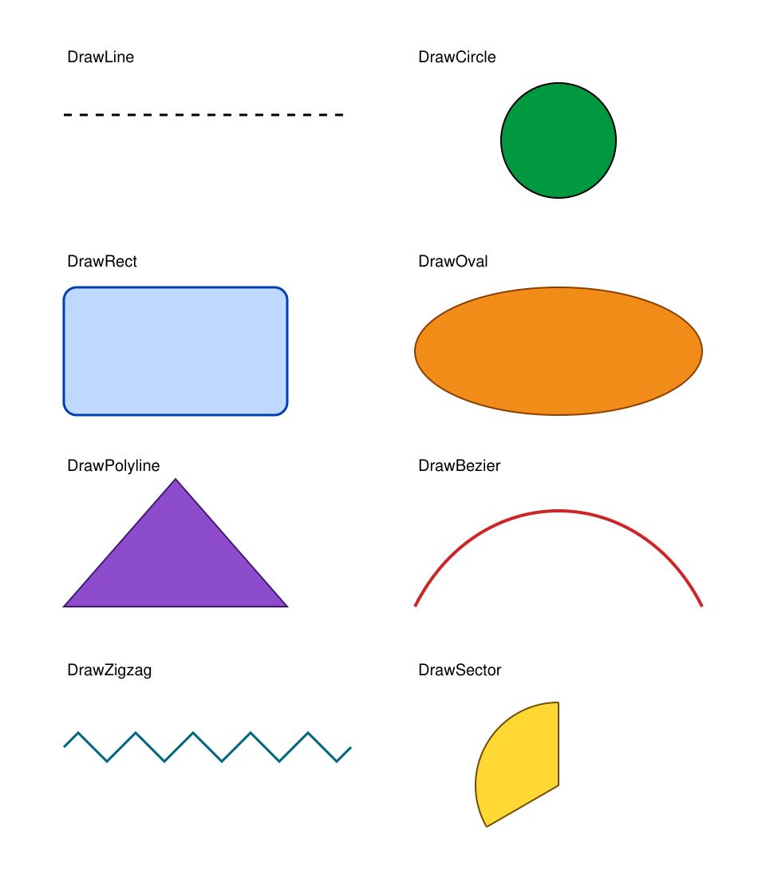

.. include:: ../../header.rst

==============================
16-DrawShapes
==============================

Draw several vector shapes on a new page with :meth:`Page.DrawLine`, :meth:`Page.DrawRect`, :meth:`Page.DrawCircle`, and related ``Page.Draw*`` methods.

GitHub: `16-DrawShapes <https://github.com/ArtifexSoftware/MuPDF.NET.Examples/tree/main/MuPDF.NET/16-DrawShapes>`_ in `MuPDF.NET.Examples <https://github.com/ArtifexSoftware/MuPDF.NET.Examples>`_.

The method creates a one-page gallery: a dashed line, a rounded rectangle, a filled circle, an oval, a closed triangle polyline, a cubic Bézier curve, a zigzag, and a pie sector.

.. code-block:: cs

    /// 
Draw lines, rectangles, circles, and other vector shapes

    static void DrawShapes(string outputPath)
    {
        using (var doc = Document.Open())
        {
            using Page page = doc.NewPage(width: 480, height: 560);
            var writer = new TextWriter(page.Rect);
            var font = new Font(fontName: "helv");

            void Label(string text, float x0, float y0)
            {
                writer.FillTextbox(new Rect(x0, y0, x0 + 180, y0 + 16), text, font, fontSize: 10);
            }

            Label("DrawLine", 40, 28);
            page.DrawLine(
                new Point(40, 72),
                new Point(220, 72),
                color: new[] { 0f, 0f, 0f },
                width: 1.5f,
                dashes: "[5] 0");

            Label("DrawCircle", 260, 28);
            page.DrawCircle(
                new Point(350, 88),
                radius: 36,
                color: new[] { 0f, 0f, 0f },
                fill: new[] { 0f, 0.6f, 0.25f },
                width: 1f);

            Label("DrawRect", 40, 156);
            // radius is a fraction of min(width, height); 0 < radius <= 0.5.
            page.DrawRect(
                new Rect(40, 180, 180, 260),
                color: new[] { 0f, 0.25f, 0.7f },
                fill: new[] { 0.75f, 0.85f, 1f },
                width: 1.5f,
                radius: 0.1f);

            Label("DrawOval", 260, 156);
            page.DrawOval(
                new Rect(260, 180, 440, 260),
                color: new[] { 0.55f, 0.25f, 0f },
                fill: new[] { 0.95f, 0.55f, 0.1f },
                width: 1f);

            Label("DrawPolyline", 40, 284);
            page.DrawPolyline(
                new[] { new Point(40, 380), new Point(110, 300), new Point(180, 380) },
                color: new[] { 0.25f, 0.1f, 0.45f },
                fill: new[] { 0.55f, 0.3f, 0.8f },
                width: 1f,
                closePath: true);

            Label("DrawBezier", 260, 284);
            page.DrawBezier(
                new Point(260, 380),
                new Point(300, 300),
                new Point(400, 300),
                new Point(440, 380),
                color: new[] { 0.8f, 0.15f, 0.15f },
                width: 2f);

            Label("DrawZigzag", 40, 412);
            page.DrawZigzag(
                new Point(40, 468),
                new Point(220, 468),
                breadth: 10,
                color: new[] { 0f, 0.4f, 0.5f },
                width: 1.5f);

            Label("DrawSector", 260, 412);
            page.DrawSector(
                new Point(350, 492),
                new Point(350, 440),
                beta: 120,
                color: new[] { 0.45f, 0.3f, 0f },
                fill: new[] { 1f, 0.85f, 0.2f },
                width: 1f,
                fullSector: true);

            writer.WriteText(page);

            Console.WriteLine("shapeCount=8");
            Console.WriteLine("DrawLine");
            Console.WriteLine("DrawRect");
            Console.WriteLine("DrawCircle");
            Console.WriteLine("DrawOval");
            Console.WriteLine("DrawPolyline");
            Console.WriteLine("DrawBezier");
            Console.WriteLine("DrawZigzag");
            Console.WriteLine("DrawSector");

            doc.Save(outputPath);
        }
    }

API: :meth:`Document.Open`, :meth:`Document.NewPage`, :meth:`Page.DrawLine`, :meth:`Page.DrawRect`, :meth:`Page.DrawCircle`, :meth:`Page.DrawOval`, :meth:`Page.DrawPolyline`, :meth:`Page.DrawBezier`, :meth:`Page.DrawZigzag`, :meth:`Page.DrawSector`, :meth:`Document.Save`.

Shapes drawn:

.. literalinclude:: shapes.txt
   :language: text

Result of ``shapes.pdf`` (page 1 rendered at 2×):

.. include:: ../../footer.rst
