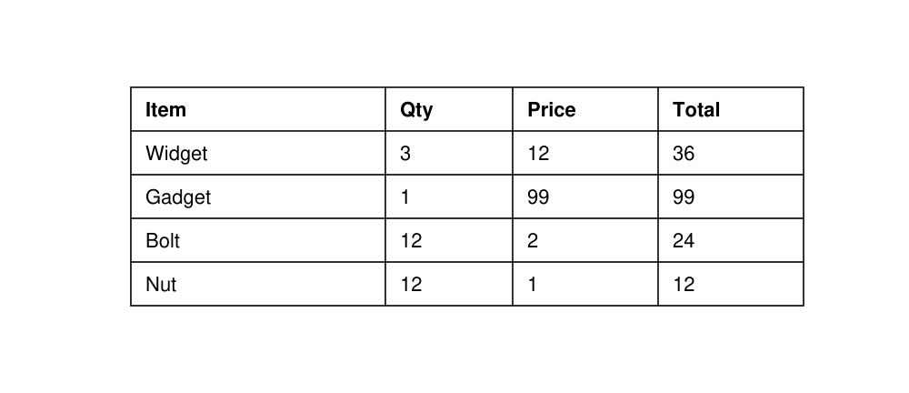

.. include:: ../../header.rst

==============================
11-Tables
==============================

Detect tables on a page and export Markdown with :meth:`Page.GetTables` and :meth:`Table.ToMarkdown`.

GitHub: `11-Tables <https://github.com/ArtifexSoftware/MuPDF.NET.Examples/tree/main/MuPDF.NET/11-Tables>`_ in `MuPDF.NET.Examples <https://github.com/ArtifexSoftware/MuPDF.NET.Examples>`_.

``tables.pdf`` is a one-page ruled grid (header plus four data rows). ``GetTables`` uses the ``lines_strict`` strategy so stroked vector lines become the table grid. ``ToMarkdown`` writes a GitHub-style markdown table.

To **convert a whole PDF to Markdown**, see :doc:`32-ToMarkdown </examples/markdown/index>`. To **write a table as CSV**, see :doc:`37-TablesCsv </examples/tablescsv/index>`.

.. code-block:: cs

    /// 
Detect tables on a page and export Markdown

    static void FindTables(string inputPath)
    {
        using (var doc = Document.Open(inputPath))
        using (Page page = doc[0])
        {
            // lines_strict uses stroked vector lines as the table grid.
            List<Table> tables = page.GetTables(
                clip: page.Rect,
                vertical_strategy: "lines_strict",
                horizontal_strategy: "lines_strict");

            Console.WriteLine($"tableCount={tables.Count}");
            for (int i = 0; i < tables.Count; i++)
            {
                Table t = tables[i];
                Console.WriteLine($"table[{i}] rows={t.RowCount} cols={t.ColCount}");
                // ToMarkdown builds a GitHub-style markdown table from cell text.
                Console.WriteLine(t.ToMarkdown());
            }
        }
    }

API: :meth:`Document.Open`, :meth:`Page.GetTables`, :attr:`Table.RowCount`, :attr:`Table.ColCount`, :meth:`Table.ToMarkdown`.

Result of ``page.GetTables``:

.. literalinclude:: tables.md
   :language: text

Result of ``tables.pdf`` (page 1 rendered at 2×):

.. include:: ../../footer.rst
