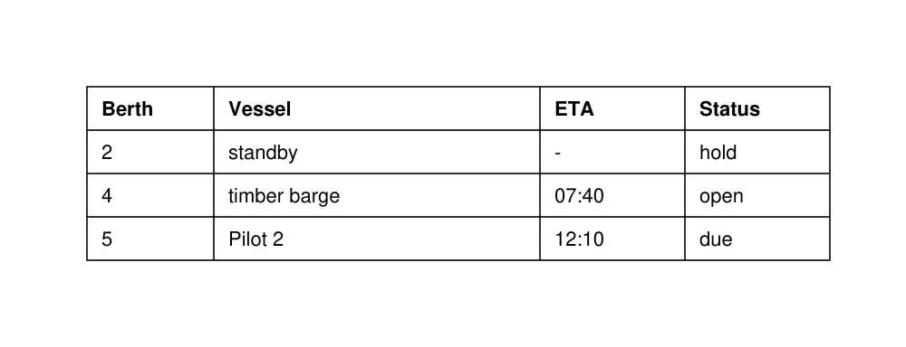

.. include:: ../../header.rst

==============================
37-TablesCsv
==============================

Detect tables on a page and write the first table as CSV with :meth:`Page.GetTables` and :meth:`Table.Extract`.

GitHub: `37-TablesCsv <https://github.com/ArtifexSoftware/MuPDF.NET.Examples/tree/main/MuPDF.NET/37-TablesCsv>`_ in `MuPDF.NET.Examples <https://github.com/ArtifexSoftware/MuPDF.NET.Examples>`_.

``tables-csv.pdf`` is a one-page ruled North Pier berth grid (header plus three data rows). ``GetTables`` uses the ``lines_strict`` strategy so stroked vector lines become the table grid. ``Extract`` returns cell text; cells with spaces are quoted in the CSV. The ``.csv`` file is UTF-8 without a BOM.

To **export a table as Markdown**, see :doc:`11-Tables </examples/tables/index>`. To **convert a whole PDF to Markdown**, see :doc:`32-ToMarkdown </examples/markdown/index>`.

.. code-block:: cs

    /// 
Detect tables on a page and write the first table as CSV

    static void TablesToCsv(string inputPath, string outputPath)
    {
        using var doc = Document.Open(inputPath);
        using Page page = doc[0];

        // lines_strict uses stroked vector lines as the table grid.
        List<Table> tables = page.GetTables(
            clip: page.Rect,
            vertical_strategy: "lines_strict",
            horizontal_strategy: "lines_strict");

        Console.WriteLine($"tableCount={tables.Count}");
        if (tables.Count == 0)
            return;

        Table table = tables[0];
        Console.WriteLine($"rows={table.RowCount} cols={table.ColCount}");
        List<List<string?>> extracted = table.Extract();

        var csv = new StringBuilder();
        foreach (List<string?> row in extracted)
            csv.AppendLine(string.Join(",", row.Select(CsvEscape)));

        string text = csv.ToString();
        File.WriteAllText(outputPath, text, new UTF8Encoding(encoderShouldEmitUTF8Identifier: false));
        Console.Write(text);
    }

    static string CsvEscape(string? cell)
    {
        string s = (cell ?? "").Replace("\r\n", " ").Replace('\n', ' ').Replace('\r', ' ').Trim();
        if (s.Contains(',') || s.Contains('"') || s.Contains(' '))
            return "\"" + s.Replace("\"", "\"\"") + "\"";
        return s;
    }

API: :meth:`Document.Open`, :meth:`Page.GetTables`, :meth:`Table.Extract`.

``tables-csv.pdf``:

CSV written to ``berth.csv``:

.. literalinclude:: berth.csv
   :language: text

.. include:: ../../footer.rst
