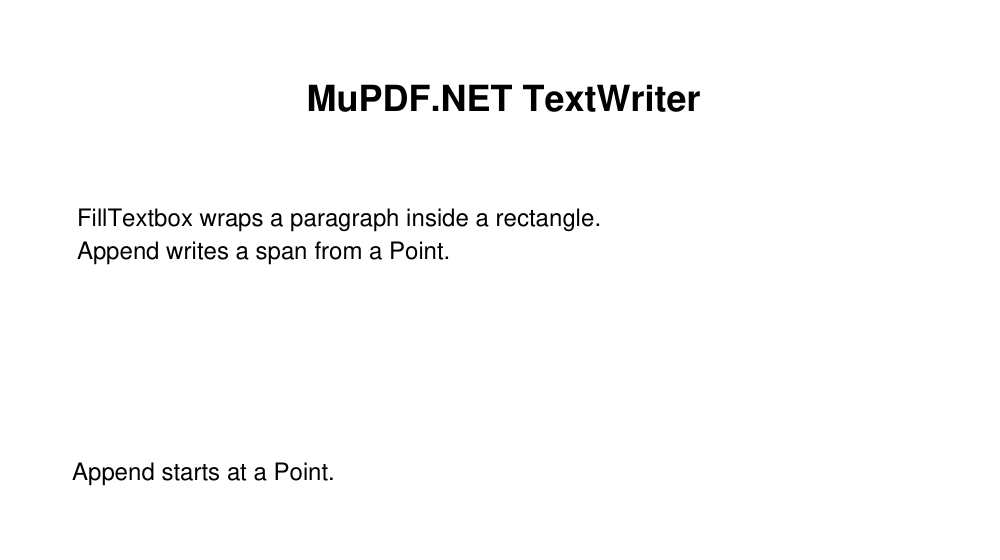

.. include:: ../../header.rst

==============================
15-TextWriter
==============================

Write text onto a new page with :class:`TextWriter` and :class:`Font`.

GitHub: `15-TextWriter <https://github.com/ArtifexSoftware/MuPDF.NET.Examples/tree/main/MuPDF.NET/15-TextWriter>`_ in `MuPDF.NET.Examples <https://github.com/ArtifexSoftware/MuPDF.NET.Examples>`_.

``FillTextbox`` wraps a paragraph inside a rectangle. ``Append`` writes a span from a ``Point``. ``WriteText`` paints the prepared spans onto the page.

.. code-block:: cs

    /// 
Write text onto a new page with TextWriter and Font

    static void WriteTextPage(string outputPath)
    {
        using (var doc = Document.Open())
        {
            using Page page = doc.NewPage(width: 500, height: 280);
            var helv = new Font(fontName: "helv");
            var hebo = new Font(fontName: "hebo");

            // TextWriter lays out spans against the page rectangle, then WriteText paints them.
            var writer = new TextWriter(page.Rect);
            writer.FillTextbox(
                new Rect(36, 36, 464, 80),
                "MuPDF.NET TextWriter",
                hebo,
                fontSize: 18,
                align: Constants.TextAlignCenter);
            writer.FillTextbox(
                new Rect(36, 100, 464, 200),
                "FillTextbox wraps a paragraph inside a rectangle.\nAppend writes a span from a Point.",
                helv,
                fontSize: 12);
            writer.Append(new Point(36, 240), "Append starts at a Point.", helv, fontSize: 12);
            writer.WriteText(page);

            Point lp = writer.LastPoint;
            Rect tr = writer.TextRect;
            Console.WriteLine(string.Create(CultureInfo.InvariantCulture,
                $"lastPoint={lp.X:0.##},{lp.Y:0.##}"));
            Console.WriteLine(string.Create(CultureInfo.InvariantCulture,
                $"textRect={tr.X0:0.##},{tr.Y0:0.##},{tr.X1:0.##},{tr.Y1:0.##}"));
            Console.WriteLine("---text---");
            Console.WriteLine(page.GetText("text") ?? "");

            doc.Save(outputPath);
        }
    }

API: :meth:`Document.Open`, :meth:`Document.NewPage`, :meth:`TextWriter.FillTextbox`, :meth:`TextWriter.Append`, :meth:`TextWriter.WriteText`, :attr:`TextWriter.LastPoint`, :attr:`TextWriter.TextRect`, :meth:`Page.GetText`, :meth:`Document.Save`.

Result of ``LastPoint``, ``TextRect``, and ``Page.GetText``:

.. literalinclude:: textwriter.txt
   :language: text

Result of ``textwriter.pdf`` (page 1 rendered at 2×):

.. include:: ../../footer.rst
