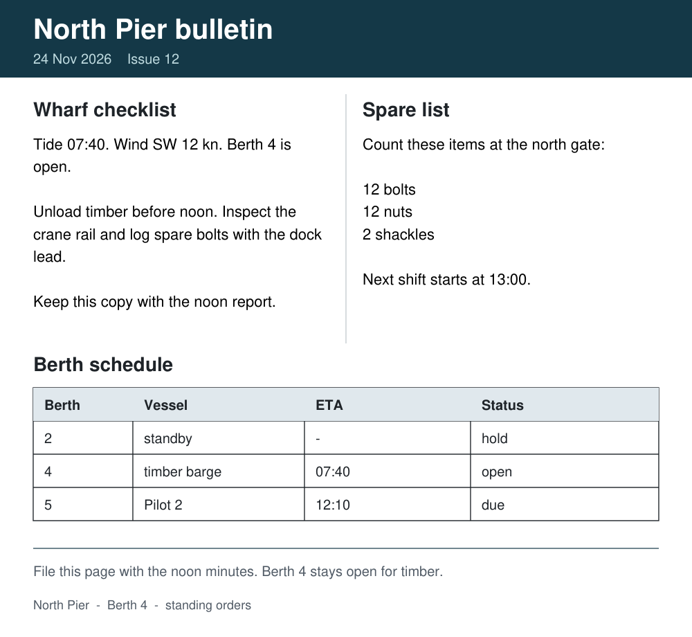

.. include:: ../../header.rst

==============================
34-ToText
==============================

Convert a PDF to plain text with ``Document.ToText``.

GitHub: `34-ToText <https://github.com/ArtifexSoftware/MuPDF.NET.Examples/tree/main/MuPDF.NET/34-ToText>`_ in `MuPDF.NET.Examples <https://github.com/ArtifexSoftware/MuPDF.NET.Examples>`_.

``bulletin.pdf`` is the same one-page North Pier bulletin as :doc:`32-ToMarkdown </examples/markdown/index>` (500×460). ``Utils.UseLayout(true)`` selects the layout path. ``Document.ToText`` writes ``bulletin.txt`` as UTF-8 without a BOM. Tables use the default ``grid`` format. ``useOcr`` is ``false`` because this PDF is already text. Without a layout worker, the method prints ``LAYOUT_UNAVAILABLE`` and skips text.

To **extract plain text** with :meth:`Page.GetText`, see :doc:`04-TextExtractSearch </examples/text/index>`. To **convert the same PDF to Markdown** with layout off, see :doc:`32-ToMarkdown </examples/markdown/index>`. For **layout JSON**, see :doc:`33-ToJsonLayout </examples/json/index>`. For **retrieval chunks**, see :doc:`35-ToChunks </examples/chunks/index>`.

.. code-block:: cs

    /// 
Convert a PDF to plain text (requires the optional layout worker)

    static void ToText(string inputPath, string outputPath)
    {
        // Remember prior layout flag so we restore it for other examples in the same process.
        bool prior = Utils.LayoutEnabled;
        try
        {
            // ToText requires UseLayout=true and a registered layout worker.
            if (!Utils.LayoutAvailable)
            {
                Console.WriteLine("LAYOUT_UNAVAILABLE");
                return;
            }

            Utils.UseLayout(true);

            using var doc = Document.Open(inputPath);
            string text = doc.ToText(showProgress: false, useOcr: false) ?? "";
            File.WriteAllText(outputPath, text, new UTF8Encoding(encoderShouldEmitUTF8Identifier: false));
            Console.WriteLine($"pageCount={doc.PageCount}");
            Console.WriteLine($"layoutEnabled={Utils.LayoutEnabled}");
            Console.WriteLine($"charCount={text.Length}");
            Console.WriteLine(text);
        }
        finally
        {
            Utils.UseLayout(prior);
        }
    }

API: :meth:`Document.Open`, :attr:`Utils.LayoutAvailable`, :meth:`Utils.UseLayout`, :meth:`Document.ToText`.

``bulletin.pdf``:

Text written to ``bulletin.txt``:

.. literalinclude:: bulletin.txt
   :language: text

.. include:: ../../footer.rst
