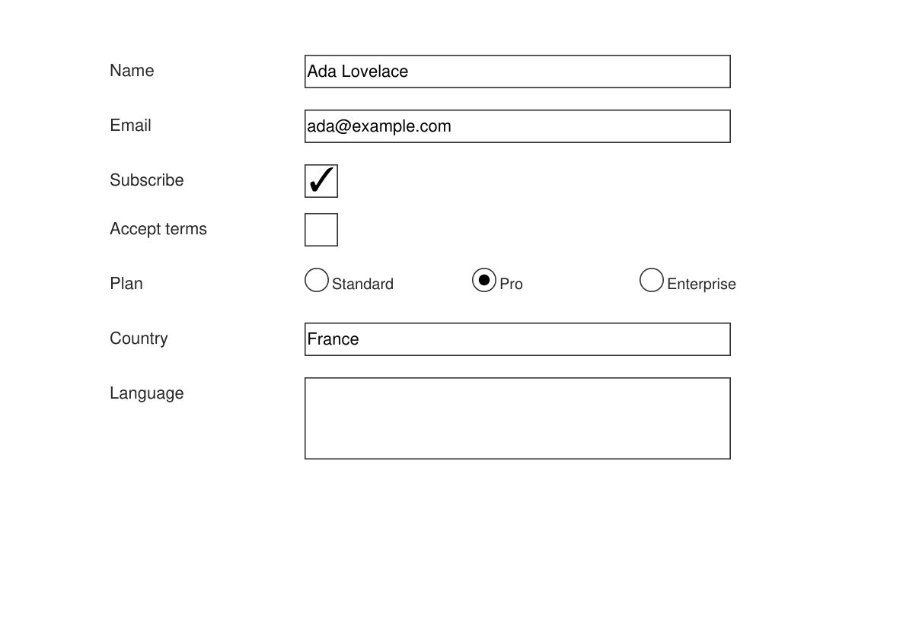

.. include:: ../../header.rst

==============================
08-FormWidgets
==============================

List AcroForm widgets on page 1 (field name, type, value).

GitHub: `08-FormWidgets <https://github.com/ArtifexSoftware/MuPDF.NET.Examples/tree/main/MuPDF.NET/08-FormWidgets>`_ in `MuPDF.NET.Examples <https://github.com/ArtifexSoftware/MuPDF.NET.Examples>`_.

``widgets.pdf`` is a one-page form with text, checkbox, radio, combo, and list fields. ``Widgets()`` walks page 0. Rows are ``FieldName``, ``FieldTypeString``, ``FieldValue``, sorted by name.

To **extract field names and values as a dictionary**, see :doc:`39-GetKeyValues </examples/getkeyvalues/index>`.

.. code-block:: cs

    /// 
List AcroForm widgets on page 1 (name, type, value)

    static void FormWidgets(string inputPath)
    {
        using (var doc = Document.Open(inputPath))
        using (Page page = doc[0])
        {
            // Widgets() walks the page's form fields.
            var widgets = page.Widgets().ToList();
            Console.WriteLine($"widgetCount={widgets.Count}");

            foreach (Widget w in widgets.OrderBy(w => w.FieldName ?? "", StringComparer.Ordinal))
            {
                // FieldTypeString is human-readable (Text, CheckBox, …).
                Console.WriteLine($"{w.FieldName}\t{w.FieldTypeString}\t{w.FieldValue}");
            }
        }
    }

API: :meth:`Document.Open`, :meth:`Page.GetWidgets` (also Widgets), :attr:`Widget.FieldName`, :attr:`Widget.FieldTypeString`, :attr:`Widget.FieldValue`.

Result of ``page.Widgets()``:

.. literalinclude:: widgets.txt
   :language: text

Result of ``widgets.pdf`` (page 1 rendered at 2×):

.. include:: ../../footer.rst
