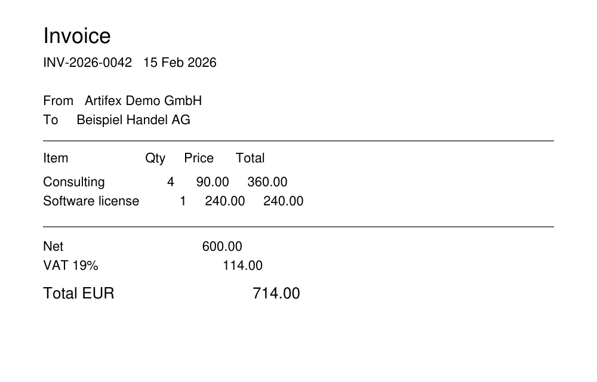

.. include:: ../../header.rst

==============================
18-ZugferdEmbedded
==============================

Embed Factur-X / ZUGFeRD XML into an invoice PDF with :meth:`Document.AddEmbeddedFile`.

GitHub: `18-ZugferdEmbedded <https://github.com/ArtifexSoftware/MuPDF.NET.Examples/tree/main/MuPDF.NET/18-ZugferdEmbedded>`_ in `MuPDF.NET.Examples <https://github.com/ArtifexSoftware/MuPDF.NET.Examples>`_.

``zugferd.pdf`` is a one-page invoice with no attachments. ``factur-x.xml`` is the ZUGFeRD payload. The method embeds it as ``factur-x.xml`` (replacing any prior file with that name) and checks a round-trip extract.

.. code-block:: cs

    /// 
Embed Factur-X / ZUGFeRD XML into an invoice PDF

    static void ZugferdEmbedded(string inputPath, string xmlPath, string outputPath)
    {
        byte[] xmlBytes = File.ReadAllBytes(xmlPath);
        const string embName = "factur-x.xml";

        using (var doc = Document.Open(inputPath))
        {
            Console.WriteLine("---before---");
            DumpEmbedded(doc);

            // Replace any prior Factur-X attachment with the same logical name.
            if (doc.GetEmbeddedFileNames().Contains(embName))
                doc.DeleteEmbeddedFile(embName);

            int xref = doc.AddEmbeddedFile(
                name: embName,
                buffer: xmlBytes,
                filename: embName,
                uFileName: embName,
                desc: "Factur-X / ZUGFeRD XML invoice");

            Console.WriteLine("---after---");
            Console.WriteLine($"xref={xref}");
            DumpEmbedded(doc);

            doc.Save(outputPath, garbage: 4, deflate: 1);
        }

        using (var doc = Document.Open(outputPath))
        {
            byte[] extracted = doc.GetEmbeddedFile(embName);
            bool match = extracted.AsSpan().SequenceEqual(xmlBytes);
            Console.WriteLine($"roundTripMatch={match.ToString().ToLowerInvariant()}");
        }

        static void DumpEmbedded(Document doc)
        {
            var names = doc.GetEmbeddedFileNames();
            Console.WriteLine($"embeddedCount={names.Count}");
            foreach (string name in names.OrderBy(n => n, StringComparer.Ordinal))
            {
                byte[] data = doc.GetEmbeddedFile(name);
                string sha = Convert.ToHexString(SHA256.HashData(data)).ToLowerInvariant();
                Console.WriteLine($"{name}\t{data.Length}\t{sha}");
            }
        }
    }

API: :meth:`Document.Open`, :meth:`Document.GetEmbfileNames` (also GetEmbeddedFileNames), :meth:`Document.DeleteEmbfile` (also DeleteEmbeddedFile), :meth:`Document.AddEmbeddedFile` (also AddEmbfile), :meth:`Document.GetEmbfile` (also GetEmbeddedFile), :meth:`Document.Save`.

Embedded files before ``AddEmbeddedFile``:

.. literalinclude:: zugferd.txt
   :language: text
   :start-after: ---before---
   :end-before: ---after---

Embedded files after ``AddEmbeddedFile``:

.. literalinclude:: zugferd.txt
   :language: text
   :start-after: ---after---

Result of ``zugferd-with-xml.pdf`` (page 1 rendered at 2×):

.. include:: ../../footer.rst
